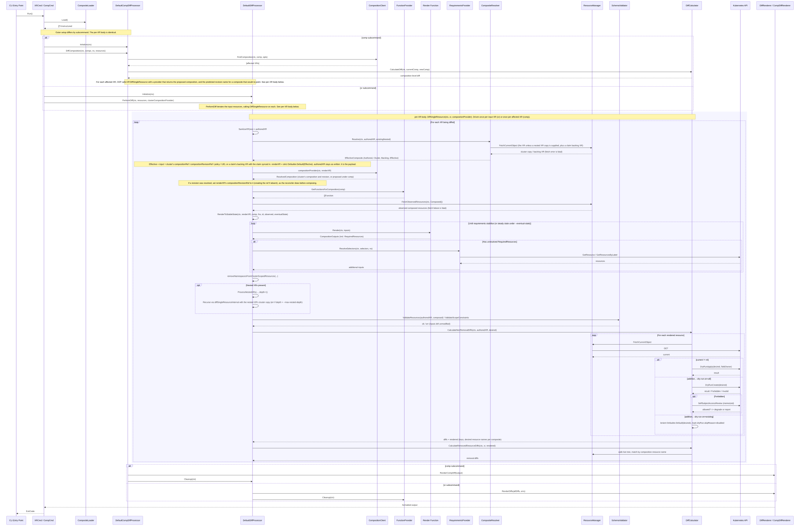

# Crossplane Diff Command - Design Document

## 1. Introduction

### 1.1 Purpose

The `crossplane-diff diff` command is a standalone tool that visualizes the differences between
Crossplane resources in a YAML file and their resulting state when applied to a live Kubernetes cluster. This is similar
to `kubectl diff` but with specific enhancements for Crossplane resources, particularly Composite Resources (XRs) and
their composed resources.

### 1.2 Guiding Principles

The design prioritizes the accuracy of the diff above all; we decline to proceed in the case of errors or ambiguity,
unless that ambiguity is the result of unknowable information (e.g., a dependency in a later pipeline step on the
`status` of an object rendered in an earlier step which will not be populated until the MR is applied by the provider).

To this end, the design reaches into the cluster _extensively_ for any information that is needed to produce a diff,
including functions, compositions, requirements (including environment configs), current state of the XR and any
downstream resources, and XRDs and CRDs for validation.

There is one exception, however, which is that in order to avoid API throttling, we cache resources on first discovery.

### 1.3 Crossplane v2 Support

This tool supports both Crossplane v1 and v2 resource definitions. A key enhancement in Crossplane v2 is the introduction
of namespaced Composite Resource Definitions (XRDs), which allows XRDs to be scoped to either `Cluster` or `Namespaced`.
The diff command automatically handles both scopes:

- **Cluster-scoped XRDs**: Traditional cluster-wide resources that exist at the cluster level
- **Namespaced XRDs**: Resources that are confined to a specific namespace, providing better isolation and multi-tenancy support

The tool reads namespace information directly from the XR definitions in the input YAML files, not from a command-line flag.
It then:
- Validates that namespaced resources have appropriate namespace settings
- Propagates the XR's namespace to managed resources that don't specify one
- Enforces scope constraints (e.g., namespaced XRs cannot own cluster-scoped managed resources, except for claims)

### 1.4 Scope

The Diff command enables users to:

- Preview changes before applying them to a cluster
- Visualize differences at multiple levels: both the XR itself and all downstream composed resources
- Support the full Crossplane composition mechanism, including functions
- Handle resource naming patterns (generateName)
- Detect resources that would be removed

## 2. Background

The Crossplane community has [long desired](https://github.com/crossplane/crossplane/issues/1805) a mechanism to
understand the would-be surface area of proposed changes to Crossplane resources. Platform administrators and
application teams would like the ability to review changes before they are applied, especially in GitOps workflows. This
requirement is particularly critical when working with complex compositions that result in multiple managed resources
being created or updated.

Currently, users lack visibility into how changes to Composite Resources (XRs) or their configurations translate to
changes in the underlying Managed Resources (MRs) and ultimately in the external systems. This makes it challenging to
understand the impact of changes, troubleshoot issues, and confidently apply updates to production environments.

## 3. Goals and Non-Goals

### 3.1 Goals

The `crossplane-diff diff` command aims to:

1. Provide a clear, familiar way to preview changes that would be made to external resources before they are applied
2. Support GitOps workflows by enabling change review within CI/CD pipelines
3. Enhance the debugging experience when working with complex compositions
4. Provide a familiar experience similar to `kubectl diff` or `argocd app diff` for Crossplane resources

### 3.2 Non-Goals

1. Perform a dry-run in the server
2. Build a GUI for visualizing differences
3. Provide historical tracking of changes over time

### 3.3 User Personas

The Diff command is designed with several distinct user personas in mind, each with different needs and permission
levels:

#### 3.3.1 CI/CD Pipeline User

**Primary Persona (Current Focus)**

This persona represents automated CI/CD workflows that run in environments with relatively unrestricted permissions:

- Generates diffs for pull request reviews
- Validates changes before deployment
- Typically runs with service account credentials that have broad read access
- Needs reliable, programmatic output that can be incorporated into reports

The current implementation primarily targets this persona, as it requires expansive permissions to query various cluster
resources needed for accurate diffing.

#### 3.3.2 Composition Developer

This persona represents DevOps engineers and platform administrators who create and maintain compositions:

- Has broad permissions to create and modify XRs and compositions
- Needs visibility into how composition changes affect downstream resources
- Uses the diff tool interactively to debug composition issues
- Requires the ability to compare different versions of compositions (particularly Composition Revisions)
- Wants to validate how changes to compositions will impact existing XRs

The current implementation supports basic modification scenarios for this persona, but the planned support for diffing
against Composition Revisions (see section 9.2) will be particularly valuable. This will enable Composition Developers
to see exactly how downstream resources from an XR would change when moving from an older to a newer Composition
Revision, providing crucial validation before promoting new composition versions to production.

The diff command, or an enhancement to the validate command, may serve this persona better in the future by allowing
validation of provider updates and their corresponding CRD upgrades against XRs and compositions that are already in the
cluster.

#### 3.3.3 End-User Developer

This persona represents application developers who consume composite resources:

- Has limited permissions, focused on specific namespaces or resource types
- Wants to understand the impact of changes to their own XRs
- May not have visibility into all dependencies or composition details
- Needs simplified output focused on resources they care about

The current implementation may not fully support this persona due to permission requirements. Future enhancements (see
section 10) will address this by allowing requirements to be supplied on the command line instead of being queried from
the cluster, or may potentially allow proceeding naively in case of insufficient permissions to read downstream objects.

### 3.4 Required Permissions

For the current implementation, the following logical permissions are required:

1. **Read access to Crossplane definitions**:
    - XRDs (CompositeResourceDefinitions)
    - Compositions
    - Composition Functions

2. **Read access to Crossplane runtime resources**:
    - Composite Resources (XRs)
    - Claims
    - Managed Resources (MRs)

3. **Read access to Crossplane configuration**:
    - EnvironmentConfigs

4. **Read access to Kubernetes resources**:
    - CRDs (CustomResourceDefinitions)
    - Resources referenced in Requirements
    - Resources referenced in templates or functions

5. **Read access to resource hierarchies**:
    - Owner references
    - Resource relationships maintained by Crossplane

6. **Dry-run write access on every GVK being diffed** (nothing is ever persisted, but the apiserver authorizes a dry
   run exactly as it would the real request):
    - `patch`, for the dry-run server-side apply against a resource that already exists. **Required, and does not
      degrade**: the diff depends on the apiserver's merge result to detect field removals, so one computed without it
      would be wrong rather than merely less detailed.
    - `create`, for the dry-run create of an addition (`--dry-run-on=all`, the default). **Degrades per-resource**: an
      addition has a usable lower-fidelity fallback (the rendered object), so a missing verb marks that resource and
      warns rather than failing the run. See §6.3.
    - `create` on `selfsubjectaccessreviews`, to disambiguate a 403 — granted to `system:authenticated` by default
      through the built-in `system:basic-user` ClusterRole.

These permissions are needed to accurately render resources, resolve requirements, validate against schemas, and
identify resources that would be removed by changes. For the CI/CD and Composition Developer personas, these permission
requirements are generally not problematic. For the End-User Developer persona, these extensive permissions may be
challenging to obtain in many organizational contexts.

## 4. Integration Test Cases

Yes, these come before the design.  The test cases covered lead to the particular implementation, and so we present them 
first as a part of requirements.

To ensure the reliability and correctness of the Diff command, comprehensive integration tests verify the functionality
across a wide range of scenarios that users may encounter in real-world usage. These test cases serve as both validation
criteria and usage examples, demonstrating the expected behavior of the command in various situations.

Each case runs against its own `envtest` apiserver. Its XR and claim CRDs are not hand-written: as in a real cluster,
they are generated from the XRDs the case applies, by upstream crossplane-runtime `pkg/xcrd` (`ForCompositeResource`,
plus `ForCompositeResourceClaim` for an XRD with `spec.claimNames`), after the XRD manifest is defaulted as the
apiserver would default it. A field an XR or claim needs is therefore added to the XRD fixture alone, and the test CRDs
cannot drift from the shape Crossplane generates (a drifted claim CRD once hid a defaulting bug, #503). Only plain CRDs
that no XRD defines, such as managed-resource stand-ins, live under `cmd/diff/testdata/{diff,comp}/crds/`; the harness
refuses to start if one of them duplicates a generated CRD. Crossplane's own CRDs (Composition, XRD, Function, …) are
installed from `cluster/gomod/crds`, which `earthly +fetch-crossplane-crds-gomod` fetches at the
`github.com/crossplane/crossplane/v2` version `go.mod` selects (the go binary in the build resolves it). They are
therefore the same version as the xcrd and render code under test, a run is reproducible, and a dependency bump moves
them automatically. The e2e suite, which runs real Crossplane images, instead uses the `cluster/<image tag>` directory
`earthly +fetch-crossplane-cluster` produces.

envtest runs no Crossplane controllers either, so what Crossplane writes to existing resources has to come from the
fixtures or the harness, and the ownership-dependent paths (composed-resource lookup by composite, the controller-UID
filter on observed resources, render's check that observed resources are controlled by the XR, removal detection from
the XR's `resourceRefs`) are only exercised if it does (#542). A case lists each existing XR with what it composes in
`crossplaneManagedResources`. The harness creates the XR plainly, server-side applies each composed resource under
Crossplane's composed field manager, gives it a controller ownerReference to the XR's real UID, as
`RenderComposedResourceMetadata` does, and records it in the XR's `resourceRefs`. That reference is what makes a
composed resource removable at all: removal detection, like Crossplane's garbage collector, considers only resources
the composite controls (§6.3.1). A reconciled XR fixture names the composition its case applies in `compositionRef`,
as Crossplane's composite reconciler writes it (#562). Only a direct `compositionRef` resolves a revision (§6.1.1), so a
fixture without one would exercise a path no reconciled XR takes, and a fixture shared by cases with different
compositions is split per composition. The harness writes a nested XR's refs with an Update, as its own reconciler
does, rather than in its parent's composed apply, so a diff of the parent's render does not report them removed. Only
XRs compose: a deeper hierarchy is a nested XR, never a managed resource with `resourceRefs`. Composed fixtures carry
only what `RenderComposedResourceMetadata` and the functions leave: no gotemplating annotation, and a `generateName`
only where the composition names nothing. A composed resource without a controlling XR, such as an orphan being
adopted, is set up as a plain fixture, and only on purpose.

What else Crossplane would have written, the harness derives rather than requires, as it derives XR and claim CRDs
from XRDs: just before it creates each `setupFiles` or `crossplaneManagedResources` fixture, it fills in whatever the
fixture leaves out. An XR gets its own `crossplane.io/composite` label, and a claim's backing XR the claim labels the
claim syncer sets from its `spec.claimRef`; a resource an XR composes (a nested XR included) gets that XR's composite
and claim labels, as `RenderComposedResourceMetadata` copies them. An XR that names
a composition but neither a revision nor a revision selector gets a `compositionRevisionRef` to that composition's
current revision. A CompositionRevision fixture without a name is named and hash-labelled as `NewCompositionRevision`
would name it, from the Composition its `crossplane.io/composition-name` label names and its own spec, labels and
annotations. A value the fixture sets always wins, which is how a case sets up a state Crossplane would not leave: a
stale or pinned revision ref, an ownership takeover, a selector matching nothing. `fieldManagerApplies`, partial
applies under a named manager, and input files are left as written.

The harness also does what the composition revision controller would, since none runs: it gives each revision a
controller reference to its Composition and creates the revision of each Composition's current hash that no fixture
declares. A revision fixture is therefore needed only to model history: an older spec, or a revision number above 1.

envtest runs each case's `kube-apiserver` and `etcd` as children of the test binary, and only a deferred
`Environment.Stop` ends them, which does not run when the binary times out, is killed or is interrupted. Such a run
leaves its servers running, reparented to PID 1, until the next run starts: so that they cannot pile up (#524),
`TestMain` then kills every envtest server whose parent is PID 1, using `cmd/diff/testutils/envtestreaper`. A live run's
servers have that run's test binary as their parent, so they are never touched.

The integration test cases cover:

### 4.1 Basic Diff Scenarios

- **New Resource Creation**: Tests that new resources show the correct additive diff output with proper color
  formatting.
- **Resource Modification**: Verifies that changes to existing resources are correctly identified and displayed.
- **Modified XR with New Downstream Resource**: Tests that when an XR is modified in a way that generates new downstream
  resources, both the modification to the XR and the creation of the new resource are properly displayed.
- **Defaulted Fields Owned by Another Manager** (#503): A field the CRD or XRD defaults, which the manifest or
  composition omits, and which another field manager has set to a non-default value in the cluster, is not reported as
  changing — for a composed resource, an XR, a nested XR and a claim. These need real field ownership, so the cases
  server-side apply their setup objects under named managers (`fieldManagerApplies`) rather than creating them, since
  a plain create records only the test client and the apiserver drops `managedFields` supplied on create. Companion
  cases under `--dry-run-on=existing` pin that additions still show their CRD and XRD defaults, predicted locally.
- **XR Defaults Reach the Render**: `XRDDefaultsReachTheRender` has a composition read a v2 XR's and a legacy XR's
  defaulted fields (a user default, and the legacy XR's `spec.compositionUpdatePolicy`) into composed resources, so an
  undefaulted render input shows up as `<no value>`. `XRDDefaultsAppliedBeforeRendering`'s composition renders
  nothing, so it pins only the XR's own dry run. A new v2 XR's `spec.crossplane.compositionUpdatePolicy` is not
  asserted: its CRD defaults the policy only inside an existing `spec.crossplane`, which a new XR's manifest lacks.
- **Claims Defaulted With Their Own CRD**: A new claim omitting every defaulted field shows its own CRD's defaults (a
  user default and `compositeDeletePolicy`, never `compositionUpdatePolicy`), whether the apiserver applies them on
  dry-run create or the lenient `Defaulter` predicts them under `--dry-run-on=existing`; and the composed resource,
  which renders the XR's `tier` and `compositionUpdatePolicy`, shows that render saw the XR CRD's defaults. Both
  CRDs are generated from the XRD fixture with `pkg/xcrd`, so they differ exactly as a cluster's do, which is what
  makes these cases, and the existing claim cases, sensitive to defaulting a claim with its XR's CRD.

### 4.2 Environment Configuration Testing

- **EnvironmentConfig Incorporation**: Tests that environment configurations are correctly incorporated into the diff
  output, showing how environment-specific values affect the rendered resources.

### 4.3 External Resource Dependencies

- **External Resource References**: Verifies that the diff command correctly handles dependencies on resources that are
  referenced but not directly managed by the XR, including:
    - Field values from external ConfigMaps
    - References to external named resources
    - Changes that affect external dependencies

### 4.4 Templating and Functions

- **Go-templating Function**: Tests diffing with templated ExtraResources embedded in go-templating functions, ensuring
  that the diff correctly processes resources generated through templates.
- **Function-sequencer Keeps Existing Resources**: Verifies that a later-stage resource function-sequencer would gate
  (its earlier stage is not Ready) is neither hidden nor reported as removed when it already exists, which holds only
  if the XR's own composed resources reach render as observed state (#259).

### 4.5 Resource Hierarchy and Removal Detection

- **Resource Removal Detection**: Tests that resources which would be removed by a change are correctly identified and
  shown in the diff output.
- **Hierarchical Resource Relationships**: Verifies that parent-child relationships between resources are correctly
  understood, including cascading removal of what a nested XR composes when the nested XR itself would be removed, at
  the v2 `spec.crossplane.resourceRefs` and the legacy `spec.resourceRefs` paths.
- **Composed Resource Deleted Out of Band**: Verifies, for both `xr` and `comp`, that a composed resource the XR still
  references but which no longer exists is left out of the observed state with a warning, rather than silently dropped.
  The fatal case (a child that cannot be read) is unit-tested only, since envtest grants the harness every permission.
- **API Version Change Is Not a Removal**: Verifies, for both `xr` and `comp`, that a composed resource the XR names
  in its `resourceRefs` at `v1beta1`, which the new revision renders at `v1beta2`, is not reported as removed, and
  that a field change rendered alongside the version change is one modification rather than an error (#552).
- **Only Controlled Resources Are Removed**: Verifies, for both `xr` and `comp`, that of the resources an XR's
  `resourceRefs` name and its render no longer desires, only the one it controls is removed. One that another XR
  controls, and one with no controller reference, stay, as Crossplane's garbage collector leaves them (#552).

### 4.6 Resource Naming Patterns

- **Resources with generateName**: Tests that resources using Kubernetes generateName pattern are correctly diffed by
  matching based on owner references rather than exact names.
- **New XR adopting an orphaned generateName resource**: Verifies that a new XR's composed resource, rendered with
  only a `generateName` and observed nowhere, is matched to an existing orphan (no controller reference, in no XR's
  `resourceRefs`) by its `crossplane.io/composite` label and composition-resource-name annotation, and shown as
  modified rather than added under a generated name.
- **New XR with generateName**: Verifies that new XRs using generateName show the appropriate placeholder in the diff
  output, including as the `xrs[]` group identity and the human-readable section header (an XR with no
  `metadata.name` must not produce a nameless group).

### 4.7 Multiple Resource Handling

- **Multiple XRs**: Tests processing multiple input files containing different XRs, ensuring that all changes are
  correctly identified and summarized.
- **Overlapping inputs**: Verifies, through real renders, that an input identical to an earlier one is diffed once
  with a warning; that the same object twice with different content fails both inputs; that a claim passed with its
  backing XR, and a child XR passed with the parent that composes it, are rejected on the managed input; and that two
  distinct XRs composing one fixed-name object fail as contention even when their renderings are byte-identical —
  which depends on real renders carrying the controller reference. Unit tests cover the remaining kinds (disagreeing
  renderings, a shared `generateName`, and a managed input's verdict superseding its own render failure). See §6.8.3.

### 4.8 Composition Selection

- **Composition Selection by Reference**: Tests selecting specific compositions using a direct reference.
- **Composition Selection by Label Selector**: Verifies that compositions can be selected using label selectors.
- **Ambiguous Composition Selection**: Tests that appropriate errors are returned when composition selection is
  ambiguous.
- **Selection Is Not Repeated**: `ExistingXRSelectingItsCompositionKeepsTheClusterCompositionRef` diffs an existing XR
  whose input selects its composition by label, where the selector now matches two compositions. Crossplane selects
  only for a composite with no `compositionRef` and never re-selects, so the XR inherits the cluster's ref (§6.4a) and
  renders the composition it is bound to, rather than failing as ambiguous.
- **Update Policy and Pinned Revisions (`xr`)**: `V2ManualPolicyOmittedRevisionRefStaysPinned` and its v1 twin diff a
  `Manual` XR whose input omits `compositionRevisionRef`; it must render the revision the cluster copy is pinned to, not
  the latest. `ExistingXROmittingRevisionRefRendersWithClusterRef` covers the same inheritance for a template reading the
  revision name (#499). `NewXRUnderManualDefaultingXRDRendersTheRevisionItNames` covers an XRD whose
  `defaultCompositionUpdatePolicy` is `Manual`: the XR is defaulted before its composition is resolved, so a new XR
  naming a revision renders that revision. The default is set on the XRD fixture, and the CRD that declares it is
  generated from that XRD by upstream xcrd, as in a real cluster.
- **Resolved Revision Reaches the Ref (`xr`)**: `AutomaticXRWithLaggingRevisionRefRendersLatestRevisionAndName` diffs an
  unchanged `Automatic` XR whose cluster ref still names the older of two revisions. Crossplane writes the revision it
  selects to the ref before composing, so the composed resource shows the latest revision's template *and* its name
  (#536); before, the latest template rendered with the stale name. `TestDefaultDiffProcessor_DiffSingleResource_RevisionRef`
  pins the write on the render input: a stale ref is overwritten, a missing one is created at the path the composite's
  schema puts it (`spec.crossplane.*`, or `spec.*` for a legacy XR), and an unknown revision leaves the ref as it is.
  `TestDefaultCompositionClient_ResolveCompositionFromRevisions` pins which revision is selected, and
  `TestDefaultCompositionClient_FindMatchingComposition` that its name is returned with the composition.

### 4.9 Claim Handling

- **New Claim Processing**: Tests that new claims are correctly processed, showing both the claim itself and its
  resulting composed resources.
- **Modified Claim Processing**: Verifies that changes to existing claims correctly propagate to their underlying
  resources in the diff output.
- **Claim Revision Sync**: `ManualClaimRendersAgainstItsBackingXRsPinnedRevision` diffs a `Manual` claim whose backing XR
  is pinned to the older of two revisions; both composition resolution and render must use that revision, so the
  composed resource shows the old revision's template *and* its name. `AutomaticClaimOmittingRevisionRefRendersWithBackingXRRef`
  diffs an unchanged `Automatic` claim whose manifest omits the ref the claim syncer copied onto the cluster copy, which
  must show no change (#498). The rules are `syncClaimSpec`'s (§6.4a), unit-tested in `TestSyncClaimSpec`;
  `TestCompositeResolver_Resolve` covers the backing-XR lookup, including a fetch error (fatal, #533) and a
  `resourceRef` naming an XR that does not exist.

### 4.10 Output Formatting and Options

- **Color Output**: Tests that color formatting is correctly applied when enabled.
- **No-color Option**: Verifies that color codes are omitted when the `--no-color` flag is used.
- **Summary Output**: Tests that the summary of changes (added, modified, removed) is correctly generated.
- **Structured Output (JSON / YAML)**: Field-level assertions on `--output json` / `--output yaml` payloads using
  `tu.AssertStructuredDiff` and `tu.AssertStructuredCompDiff` builders. These let tests assert on specific old/new
  values and on summary counts without depending on ANSI escape sequences. Errors must appear in both stderr (printed
  once, by the command) and the structured output.
- **Typed Validation Failures**: Schema-validation tests use the fluent `WithError` / `WithValidationFailure` /
  `WithFieldError` builder chain to pin specific GVKs, namespaces, statuses, error types (`schema`, `cel`,
  `unknownField`, `defaulting`), and field paths. Message wording is intentionally not asserted so apimachinery
  upgrades can shift phrasing without breaking tests.
- **Unverified-Addition Summary**: Additions whose dry-run create was skipped are summarised as one counted warning
  per GVK + namespace + cause, asserted with `WithWarning` / `WithWarningContext` (including `count`) and on stderr —
  across several `xr` inputs, and through `comp` as one run-wide summary.

### 4.11 Composition Diff Scenarios

The `comp` subcommand has its own set of integration tests:

- **Affected XR Enumeration**: Verifies that all XRs using the proposed composition are correctly listed.
- **Composition-level Diff**: Tests that the top-level composition diff is rendered alongside per-XR impact.
- **Filtering**: Covers `--namespace`, `--resource [namespace/]name`, and `--include-manual`. The
  `--namespace`/`--resource` mutual-exclusion error path is exercised. The `--resource` preflight (every named ref must
  match at least one input composition) is exercised.
- **Update Policy Handling**: Verifies that `Manual` XRs are excluded by default and included with `--include-manual`,
  and that both v1 (`spec.compositionUpdatePolicy`) and v2 (`spec.crossplane.compositionUpdatePolicy`) are honoured.
- **Revision Selector Handling**: Verifies that an Automatic XR whose `compositionRevisionSelector` does not match the
  diffed composition's labels is surfaced as `filtered` with reason `revision_selector_mismatch`, and that
  `--include-manual` does not re-include it (it would not select the resulting revision). The predicate honours both
  `matchLabels` and `matchExpressions` and both v1/v2 field paths.
- **Unchanged-Composition Skipping**: Verifies that a composition identical to its in-cluster version skips impact
  analysis (marked `ImpactAnalysisSkipped`, exit code 0 even when the fixtures would otherwise report a downstream
  delta), that `--analyze-on=always` (and its deprecated `--analyze-unchanged` equivalent) evaluates the composites anyway,
  and that a difference confined to a masked field still counts as changed so the analysis is not silently skipped — for
  both kinds of mask: the user's `--ignore-paths`, and the comparison's (package `compare`) display-only suppressions (a cluster-only
  `kubectl.kubernetes.io/last-applied-configuration` annotation). The display-only case is covered at both levels: as a
  comparison verdict in `TestDefaultCompDiffProcessor_calculateCompositionDiff`, and end-to-end through the real CLI
  wiring in `TestCompDiffIntegration/CompositionAppliedWithKubectlEvaluatesXRs`, which is what pins
  `defaultProcessorOptions` not folding the annotation into `--ignore-paths` (see §6.8).
- **Analysis-Trigger Threshold**: `TestChangeScope_triggersAnalysis` pins the `--analyze-on` decision table as a matrix
  of scope against setting, asserting it stays monotonic (anything `spec-change` analyses, `any-change` also analyses,
  `always` analyses everything) and that the zero-value `AnalyzeOn` — reachable by any caller constructing a
  `ProcessorConfig` directly — behaves as the CLI default rather than analysing nothing.
  `TestCompDiffIntegration/AnalyzeOnSpecChangeSkipsMetadataOnlyChange` covers the same threshold end-to-end: a
  metadata-only change under `--analyze-on=spec-change` goes unevaluated, yet `revisionImpact` still reports
  `changeScope: metadata`, `createsRevision: true` and the one composite that would adopt the revision, with exit code 0.
  That pairing is what pins the flag as a cost knob rather than a correctness mode.
- **What a Skip May and May Not Suppress**: `TestDefaultCompDiffProcessor_DiffComposition_ResourceMode/SkipReportsFilterConsequences`
  pins the boundary as a matrix of `--analyze-on` against `--include-manual` against `--resource` (`Scoped`): a skipped
  analysis still reports `AffectedResources.Total`, the per-reason filter counters, and the individual `filtered`
  entries, while withholding only the changed/unchanged/errored verdict. The same cases pin that a Manual composite kept
  by `--include-manual` is not counted in `RepointedComposites`, and is marked `Pinned`, so a run can never report zero
  affected composites beside a non-zero re-point count (issues #478, #479).
  `TestDefaultCompDiffProcessor_DiffComposition/AnalyzeOnSpecChangeStillReportsFilteredComposites` and the
  `SkippedAnalysis*` cases in `TestDefaultCompDiffRenderer_RenderCompDiff` cover the human-readable side, including that
  a skip with nothing filtered still prints the skip note alone.
- **Revision Identity and Seeding**: `TestCompDiffIntegration/RevisionNamePropagatesToComposedResource` is the flagship,
  and the regression test for the whole of issue #474: a metadata-only composition edit (one added label, byte-identical
  spec) whose template reads the CompositionRevision name off the composite and propagates it into a composed resource.
  The rendered output genuinely changes, so the run exits 3 — where before the fix, rendering the composite with its
  *existing* `compositionRevisionRef`, it reported the composite as unchanged with no downstream changes and exited 0.
  Stop `comp`'s composition provider resolving the predicted revision, or the processor writing a resolved revision to
  the ref, and this is what fails. It also pins the two things that keep the result
  readable: `predictedRevisionName` is matched by pattern (`^…-[0-9a-f]{7}$`) rather than literally, so editing the
  fixture is not a test failure, and the composite's own `spec.crossplane.compositionRevisionRef` diff is deliberately
  *absent*. `ClaimRevisionNamePropagatesToComposedResource` is the claim variant: the name must reach the backing XR's
  ref, since the claim's own is never propagated under `Automatic`, and `ClaimRendersWithBackingXRRevisionWhenNothingIsSeeded`
  pins that an unseeded claim renders with the backing XR's current ref rather than none (#498). The claim fixture
  carries the ref the claim syncer copies back under `Automatic`, as a real claim does.
  Underneath it, `TestRevisionIdentity` pins the mirrored `<composition>-<hash[:7]>` derivation exactly, including
  upstream's `>=` truncation guards at both bounds (63 characters for the hash label value, 7 for the name suffix) and
  the `"unknown"` sentinel `Composition.Hash()` returns on a marshal error, which is shorter than either bound.
  `TestDefaultCompDiffProcessor_partitionXRsByUpdatePolicy` (its `wantRepointing`) and
  `TestDefaultCompDiffProcessor_collectXRDiffs_RevisionName` cover which composites the provider resolves to the name
  (a re-pointing one, and a claim through its backing XR; not a `Manual` one, nor one whose selector rejects the new
  revision, and none when it is unpredictable), and that the supplied composites — the cluster's objects — are never
  mutated. `RevisionNameReachesOnlyRepointingCompositesWithIncludeManual` covers the `Manual` case end-to-end: under
  `--include-manual` the Automatic composite's downstream shows the predicted name while a `Manual` composite pinned
  to an older revision renders unchanged. `AutomaticSelectorOnCompositionHash_Kept` pins the other consumer of
  the prediction: a composite whose `compositionRevisionSelector` keys on `crossplane.io/composition-hash` is now kept
  rather than dropped as a selector mismatch. The unpredictable case is covered on both sides of the skip:
  `revisionNamePredictable` is folded into `TestDefaultCompDiffProcessor_calculateCompositionDiff`'s want-struct across
  every case (with `LastAppliedConfigurationPlusRealEdit_StillPredictable` pinning that the guard fires only when the
  annotation is the *sole* delta), and end-to-end by `CompositionAppliedWithKubectlEvaluatesXRs` (evaluated, at the
  default) and `AnalyzeOnSpecChangeSkipsMetadataOnlyChange` (skipped, under `--analyze-on=spec-change`), which both
  assert `predictedRevisionName` absent with `createsRevision` still true; the former also asserts the warning on stderr.
- **Human Revision Messages**: `TestSkippedMessage` and `TestRevisionImpactMessage` close a previously-zero-coverage gap.
  `TestSkippedMessage` pins the strong-vs-weak claim distinction the two skip paths must keep apart (see §6.2 step 3a) —
  which had no coverage at all, so forcing the strong claim for both cases previously passed the whole suite.
  `TestRevisionImpactMessage` pins the evaluated-run line: that it reports the churn *without* naming the revision, that
  it says nothing when no revision is created or when nothing would adopt one, and that it reads identically whether or
  not the name was predictable (the warning on stderr is the right channel for "this could not be checked").
  `TestRenderCompDiff_RevisionImpactLine` pins that the churn is stated exactly once per composition — by one message or
  the other, never both, and by neither for a composition that creates no revision — and that the predicted name's hash
  suffix never reaches human stdout by *any* route.
- **Change-Scope Classification**: `TestDefaultCompDiffProcessor_calculateCompositionDiff` covers the `spec` scope
  alongside its metadata cases — `SpecDifference_ScopeIsSpec` for a plain pipeline edit, and
  `SpecDifferenceMasked_ScopeStillSpec` for the same edit hidden behind `--ignore-paths`, which must not be able to
  downgrade the scope or `--analyze-on=spec-change` would skip a composition that genuinely renders differently.
- **Deletion Handling**: Verifies that an XR carrying a `metadata.deletionTimestamp` is excluded from impact analysis
  with reason `deleting` (counted via `FilteredByDeletion`, and surfaced as a `filtered` impact entry in `--resource`
  mode), that `--include-manual` does not re-include it, and that an explicitly-null `deletionTimestamp` (how
  round-tripped Kubernetes YAML spells "unset") is not mistaken for a deleting XR.
- **Downstream Field Changes**: Asserts field-level old/new values on composed resources of affected XRs.

### 4.12 Nested XRs and Eventual State

- **Nested XR Recursion**: Tests that composed XRs are themselves diffed, with identity preserved across renders by
  fetching observed state. `NestedXRInheritsClusterRevisionRef` pins that a nested XR, rendered from its parent's output
  (which never carries a ref), inherits its cluster copy's `compositionRevisionRef` like a root XR (§6.4a).
- **`--max-nested-depth`**: Verifies the recursion limit short-circuits cleanly — that a cyclic composition terminates
  with a "maximum nesting depth exceeded" error instead of exhausting the stack, that `--max-nested-depth 1` refuses a
  second level of nesting, and that it still accepts a tree exactly one level deep (the bound is inclusive). The unit
  tests drive the guard with a render stub that caps its own recursion, so a regression fails an assertion rather than
  the test binary; integration tests separately drive a real two-kind cycle (`XCycleA` → `XCycleB` → …) through real
  renders for **both** `xr` and `comp`, since `comp` shares the recursion. For `comp`, whose top-level error only
  counts failed composites, they assert the depth message reaches the failing composite's impact entry.
- **Two-phase Diff**: Verifies that resources rendered only by nested XRs are not falsely flagged as removals.
- **`--eventual-state`**: Tests multi-stage compositions (e.g., function-sequencer / `function-conditional`) whose
  full effect requires multiple reconciliation cycles. Each gating composition is covered both for a new XR and for an
  existing XR whose first stage exists but is not Ready yet, which must still reveal the later stage (#564); and an XR
  whose stages are all Ready shows only its real changes.

### 4.13 Claim Edge Cases

- **New Claim with `spec.claimRef`**: Verifies that compositions referencing
  `.observed.composite.resource.spec.claimRef.*` render correctly for new claims (no backing XR yet exists), via the
  synthesised dummy XR.
- **Backing XR Missing or Unreadable**: `TestCompositeResolver_Resolve` pins that a `resourceRef` naming an XR that does
  not exist is synthesized under the ref's name (the XR the claim syncer would create), with a warning, and that any
  other error fetching the backing XR fails the diff (#533).
- **`crossplane.io/composite` Label**: Confirms that diffing a Claim does not show spurious changes to the composite
  label, since Crossplane uses the XR name there even when rendering from a Claim.

### 4.14 Scoped Cluster Access

The diff reads only what its input needs, so a run's cost and its required permissions don't grow with the rest of
the control plane.

- **Least-Privilege Credentials** (`xr` and `comp`): the case runs the command as the cluster admin and then as an
  envtest user bound to a ClusterRole (the case's `rbacRules`) that grants `get`, not `list`, on Crossplane's own types.
  It grants `list` only on CompositionRevisions and composed resources, which are selected by label, and, for `comp`
  without `--resource`, on the composition's XR type. Both runs must print identical JSON.
- **Unrelated XRD Without a CRD**: an XRD the input doesn't use, applied with no generated CRD (the case's
  `unestablishedXRDs`, as for an XRD Crossplane hasn't established yet), leaves the diff unchanged.
- **Name-Scoped `comp` Without Composite List**: `comp --resource` looks composites up by name, so a user who cannot
  list the XR type gets the admin's impact analysis.
- **Missing Function**: a pipeline step naming a Function the cluster doesn't have fails the diff, naming the function
  and the step.

These comprehensive test cases ensure that both subcommands function correctly across the full range of Crossplane
resource types and composition patterns. The implementation described in the following sections is designed to satisfy
all these test cases.

## 5. Architecture Overview

### 5.1 High-Level Overview

The `crossplane-diff` binary exposes two diff subcommands and a `version` subcommand:

- **`crossplane-diff xr [FILE]…`** (alias: `diff`) — given one or more XR or claim YAMLs, show the changes that would
  result from applying them to the cluster.
- **`crossplane-diff comp [FILE]…`** — given one or more updated Composition YAMLs, find every XR in the cluster that
  uses each composition and show the impact of the composition change on each, including a top-level diff of the
  composition itself.

Both subcommands process resources from files or stdin, compare them against the current state in the cluster, and
display differences in a familiar format. They share the same underlying per-XR rendering and diffing machinery — `comp`
delegates to the same `DiffProcessor` that `xr` uses, supplying the proposed composition through a `CompositionProvider`
callback.

The implementation leverages existing Crossplane and Kubernetes machinery to:

1. Find the appropriate composition for a composite resource (or use the user-supplied one for `comp`)
2. Extract dependency information from composition functions
3. Perform a simulated reconciliation through the render pipeline
4. Use server-side dry-run to determine resource-level changes without applying them
5. Walk the live resource tree to detect resources that would be removed

The XR-diff flow is:

1. Load resources from files/stdin
2. For each XR or claim:
    1. Resolve the matching composition
    2. Render the XR through the composition pipeline
    3. While the render reports new `RequiredResources` selectors, resolve them and re-render
    4. Recurse into any nested XRs (subject to `--max-nested-depth`), preserving their identity by fetching their
       observed state from the cluster
    5. Validate the rendered tree against CRD/XRD schemas and enforce scope constraints
    6. Compare against current state in the cluster (server-side dry-run + tree walk)
3. Format and display differences in the configured output format

The composition-diff flow layers on top of this: discover affected XRs in the cluster, optionally filter by namespace
or resource refs, drop XRs with `Manual` update policy unless `--include-manual` is set, run the per-XR flow above for
each, and aggregate into a `CompDiffOutput`.

### 5.2 Architectural Layers

The Crossplane Diff command follows a layered architecture pattern with clear separation of concerns. Each layer has
specific responsibilities and depends only on lower layers.


*Figure 1: Conceptual layers of the Crossplane Diff command architecture and their responsibilities*

#### 5.2.1 Command Layer

The top-level layer that handles command-line arguments, flags, and coordinates the execution flow.

**Key Components:**

- `Cmd`: Main command structure that processes arguments and flags
- Help functions: Provides usage instructions to users

**Responsibilities:**

- Command parsing
- Argument validation
- Help text generation
- Entry point coordination

#### 5.2.2 Application Layer

The orchestration layer that initializes the application context and coordinates the overall diff process.

**Key Components:**

- `AppContext`: Holds application-wide dependencies and clients
- `DiffProcessor`: Orchestrates per-XR diffing (used directly by `xr`, held as a named `xrProc` field on `DefaultCompDiffProcessor`)
- `CompDiffProcessor`: Orchestrates composition-impact diffing for `comp`
- `Loader`: Handles loading resources from files or stdin

**Responsibilities:**

- Context management
- Client initialization
- Process coordination
- Resource loading
- Result aggregation
- Cleanup of ephemeral state (Docker function containers, networks)

#### 5.2.3 Domain Layer

The business logic layer containing the core diff functionality, resource management, and rendering.

**Key Components:**

- `DiffCalculator`: Computes differences between resources (split into non-removal and removal phases for nested XRs)
- `SchemaValidator`: Validates resources against their schemas and enforces scope constraints
- `ResourceManager`: Fetches cluster state and manages owner references
- `CompositeResolver`: Computes the effective composite, what Crossplane would reconcile for an XR or claim
- `RequirementsProvider`: Resolves environment-config and label-selector requirements between render iterations
- `FunctionProvider`: Resolves the function set for a composition, with strategies for caching and registry override
- `compare.GenerateDiff`: Compares two objects into a `ResourceDiff` (cleanup, ignore paths, line diff)
- `DiffRenderer` / `CompDiffRenderer`: Format and display XR and composition diffs (human-readable or structured
  JSON/YAML)
- `Render Function`: Handles composition-pipeline rendering; normally a reference to the upstream `render` package

**Responsibilities:**

- Diff calculation
- Resource rendering
- Resource management
- Schema validation
- Requirement processing
- Diff visualization

#### 5.2.4 Client Layer

The infrastructure access layer that interfaces with Kubernetes and Crossplane.

**Key Components:**

- Kubernetes Clients: `AccessChecker`, `ApplyClient`, `ResourceClient`, `SchemaClient`, `TypeConverter`
- Crossplane Clients (injected via `AppContext`): `CompositionClient`, `CredentialClient`, `DefinitionClient`,
  `EnvironmentClient`, `FunctionClient`, `ResourceTreeClient`. `CompositionRevisionClient` is not part of the injected
  bundle — `DefaultCompositionClient` constructs and owns one internally.

**Responsibilities:**

- Kubernetes API interaction
- Crossplane resource access
- Resource conversion
- Type handling
- Dry-run apply and dry-run create
- Authorization checks

#### 5.2.5 External Systems

The actual Kubernetes API server and cluster resources that the command interacts with.

**Responsibilities:**

- Kubernetes API server
- Resources in cluster
- CRDs and schemas


*Figure 2: Layered architecture showing the main components in each layer and the dependencies between layers*

### 5.3 Data Flow

The data flow through the system follows these key steps:


*Figure 3: Data flow through the Crossplane Diff command system*

1. **Input Processing**:
    - YAML files or stdin content is loaded and parsed into unstructured resources

2. **Processing**:
    - For each Composite Resource (XR) or Claim:
        - Resolve the effective composite (inherit cluster-written fields, default with the XR's CRD)
        - Find the matching composition and its revision
        - Render the XR and composed resources using Crossplane functions
        - Discover and resolve requirements for rendering, iterating until the render is stable
        - Validate the rendered resources against schemas and scope
        - Recurse into nested XRs
        - Phase 1: dry-run apply each resource and compare it with `compare.GenerateDiff`
        - Phase 2: detect resources the composite no longer composes

3. **Output**:
    - Clean up function containers
    - Render the diffs as text, JSON or YAML to stdout; the returned error is printed once, to stderr, by the command

## 6. Component Design


*Figure 4: DiffProcessor architecture showing its subcomponents and their relationships*

### 6.1 DiffProcessor

The `DiffProcessor` is the central component for XR diff. It uses a dependency injection pattern with factories for its
subcomponents. `DefaultCompDiffProcessor` (see §6.2) holds one as a named `xrProc` field and delegates per-XR rendering to it.

#### 6.1.1 Interfaces and Implementation

```go
// DiffProcessor interface for processing resources.
type DiffProcessor interface {
    // PerformDiff processes all resources and returns the report for the command to render; it
    // writes no output itself. The report is non-nil whenever resources were processed, even when
    // the error is not, so the successful XRs' results are still rendered. Its HasChanges is the
    // run's "has diffs" verdict.
    PerformDiff(ctx context.Context, resources []*un.Unstructured, compositionProvider types.CompositionProvider) (*dt.XRReport, error)

    // DiffSingleResource processes one resource and returns its diffs without rendering them.
    // Used by CompDiffProcessor to drive per-XR diffs.
    DiffSingleResource(ctx context.Context, res *un.Unstructured, compositionProvider types.CompositionProvider) (map[string]*dt.ResourceDiff, error)

    // Initialize prepares the processor. It fetches no CRDs or XRDs: each is fetched when a resource
    // being diffed needs it.
    Initialize(ctx context.Context) error

    // Cleaner releases resources held by the processor (in particular, Docker function containers
    // started during rendering — without this they leak for the lifetime of the process).
    Cleaner
}

// Cleaner is anything holding resources that CleanupDetached can release. DiffProcessor,
// CompDiffProcessor and FunctionProvider all embed it.
type Cleaner interface {
    Cleanup(ctx context.Context) error
}

// XRReport (in result) is everything a DiffRenderer renders for one xr run.
type XRReport struct {
    Groups   []XRDiffGroup   // one per input, in input order
    Errors   []OutputError   // union: every group's error, overlaps, and the interruption entry
    Warnings []OutputWarning // the run's advisories, sorted, collected after Cleanup
}
```

The processors compute and the command presents (§6.8.2). `XRCmd.Run` renders the report with the renderer it builds
from its flags, then derives the exit code from the processor's error and `HasChanges`.

A `CompositionProvider` is `func(ctx, *Unstructured) (types.ResolvedComposition, error)`. The `xr` subcommand passes a
provider that looks up matching compositions in the cluster; the `comp` subcommand passes one backed by the updated
composition file under test, so the same per-XR diff machinery serves both flows. The provider is handed the
effective composite, defaulted (§6.4a, §7.1), never the raw input: for a claim, that is its backing XR.

```go
// ResolvedComposition is what a CompositionProvider resolves for one composite (in cmd/diff/types).
type ResolvedComposition struct {
    // Composition is the composition to render the composite against.
    Composition *apiextensionsv1.Composition

    // RevisionName is the CompositionRevision Composition comes from. Empty means unknown (a composition
    // with no revisions yet, say), and the composite then keeps the ref it has.
    RevisionName string
}
```

The provider is the one source of truth for which revision applies. Crossplane's composite reconciler resolves a
revision, writes it to the composite's `compositionRevisionRef`, and only then composes (`APIRevisionFetcher.Fetch`
returns the current ref untouched only for a `Manual` composite that already has one; otherwise it sets the ref to the
latest revision, creating it if absent). The processor mirrors that: when `RevisionName` is set it writes it to the
render input's `compositionRevisionRef`, creating the ref if there is none, at the path the composite's schema puts it
(`spec.crossplane.*`, or `spec.*` for a legacy XR; the same schema decision render uses). So a template reading the
revision name sees the revision that rendered it (#536). Only the render input carries it: the dry-run payload stays the
composite as authored (§6.4a), and a name is never made up when the provider does not know one.

- The cluster lookup (`CompositionClient.FindMatchingComposition`) names the revision `resolveCompositionFromRevisions`
  selects for a composite that references its composition by name, which every composite Crossplane has reconciled
  does: under `Automatic`, the latest matching its `compositionRevisionSelector`; under `Manual`, the pinned one, or
  the latest when there is no ref yet. A composition with no revisions, or one chosen by label selector or by type,
  resolves none.
- `comp`'s provider names the revision the diffed composition would produce for a composite rendered against it that
  would re-point at that revision (§6.2 step 3a).

The `DefaultDiffProcessor` uses several subcomponents:

- `fnProvider`: Resolves the function set for a given composition (see §6.6)
- `compClient`, `defClient`, `schemaClient`, `treeClient`, `applyClient`: Cluster I/O (see §6.8)
- `compositeResolver`: The `CompositeResolver` (§6.4a) that computes the effective composite
- `schemaValidator`: Validates resources against schemas and enforces scope constraints
- `renderDefaulter`: The strict `Defaulter` (§6.5a) that defaults the effective composite
- `diffCalculator`: Calculates differences between resources; holds the lenient `Defaulter` (§6.5a)
- `requirementsProvider`: Handles requirements (env-configs, label selectors) for rendering

#### 6.1.2 Configuration

The `ProcessorConfig` structure provides configuration options. It holds no presentation settings: `--output`,
`--output-version`, `--no-color`, `--compact` and the output writers reach only the renderer the command builds
(§6.8.2).

- `MaxNestedDepth`: Recursion limit for nested-XR diff (`--max-nested-depth`) — the number of levels of nesting
  permitted below the XR the user named. Exceeding it fails the diff (see §7.1).
- `MaxRenderIterations`: Cap on the requirements-discovery loop (`--max-iterations`).
- `IncludeManual`: For `comp`, also consider XRs whose composition update policy is `Manual`.
- `AnalyzeOn`: For `comp`, the smallest composition change that triggers per-composite impact analysis — one of
  `AnalyzeOnSpecChange`, `AnalyzeOnAnyChange` (the zero value, matching the `--analyze-on` default) or `AnalyzeOnAlways`
  (see §6.2 step 3a). Evaluating a composite costs one function render, so this is a cost knob, never a correctness
  mode: `RevisionImpact` is populated at every setting and composites left unevaluated are marked
  `ImpactAnalysisSkipped`, so no consequence is suppressed — only the amount of work spent looking for a rendered effect
  varies. The CLI's `--analyze-unchanged` is a deprecated way to ask for `AnalyzeOnAlways`; `CompCmd.analyzeOn` resolves
  the two, and `validateFlags` hard-errors when they disagree. `--analyze-on` carries an *empty* kong default rather
  than `any-change` so that "not passed" stays distinguishable from "passed explicitly" at that check — which is why
  `--help` states the default in prose rather than showing it as a value.
- `DryRunOn`: Which resources are round-tripped through the apiserver to compute their post-apply form — one of
  `DryRunOnExisting` or `DryRunOnAll` (the zero value, matching the `--dry-run-on` default; see §6.3). The same kind of
  knob as `AnalyzeOn`: each round-trip costs an apiserver call and a permission, and every resource left un-verified is
  marked with a `DryRunInfo` (§6.8.3), so "we did not check" stays distinguishable from "we checked and this is what the
  cluster would store". Unlike `--analyze-on`, a plain kong `default:"all"` is correct here — degradation is uniform, so
  no behaviour depends on telling a defaulted value from an explicitly-passed one. It is set from
  `CommonCmdFields.DryRunOn`, which lives on the struct shared by `xr` and `comp`, so both subcommands get the flag;
  `WithDryRunOn` ignores an empty value so the config default survives.
- `Advisories`: The `*AdvisoryCollector` advisories are raised on and drained from for structured output (§6.8.1). The
  CLI passes one collector to both processors of a run, built with the command's stderr, so each advisory is written
  there as it is raised. Unset, each processor builds a collect-only one (`NewAdvisoryCollector(nil)`).
- `EventualState`: Synthesize composed-resource readiness between render iterations to model the steady state of
  multi-stage compositions (`--eventual-state`).
- `IgnorePaths`: Field paths to suppress from diffs (e.g., status fields known to be reconciler-set).
- `FunctionCredentials`: Image-pull credentials for private function registries.
- `FunctionRegistryOverride`: Rewrites function image references to a mirror.
- `MaxRecvMessageSize`: Max gRPC message size (MB) for render function containers, injected as their
  `MAX_RECV_MESSAGE_SIZE` env var (`--max-recv-message-size`, or the same-named env var on crossplane-diff itself).
  Zero leaves the function's own default (4MB for function-sdk-go); only functions that read the variable honor it.
- `CrossplaneRenderBinary`: Optional path to an external `crossplane render` binary (otherwise the in-process render
  package is used).
- `CrossplaneVersion`: Optional pinned render version; the docker engine pulls `…/crossplane:<version>` instead of
  `:stable`. Validated against `MinCrossplaneRenderVersion` (v2.3.4) at the CLI layer, and normalized to a
  `v`-prefixed tag by `NormalizeRenderVersion` inside `NewEngineRenderFn` — validation accepts a bare `2.3.4`, but
  upstream formats the value into the tag verbatim and publishes only `v`-prefixed tags.
- `CrossplaneImage`: Optional full render image reference (e.g. a private mirror). Mutually exclusive with
  `CrossplaneVersion` and `CrossplaneRenderBinary`. Floor-checked at the CLI layer whenever its tag parses as a
  semantic version; a reference with no comparable version draws a warning instead (see §8.1).
- `Logger`: Structured logger, propagated to all subcomponents.
- `RenderFunc`: Renders a composition pipeline; defaults to the in-process engine.
- `Factories`: Factory functions for creating subcomponents (used for testing and to swap caching strategies).
  `Factories.Defaulter` (set with `WithDefaulterFactory`, defaulting to `NewDefaulter`) takes a `DefaultingPolicy`; the
  processor calls it twice, for its own strict `renderDefaulter` and for the lenient one it hands to the
  `DiffCalculator` factory (see §6.5a). `Factories.InputValidator` (set with `WithInputValidatorFactory`, defaulting to
  `NewBundleInputValidator`) creates the `InputValidator` for each `PerformDiff` run (see §6.7a).

Note: `comp`'s `--namespace` filter and `--resource` filter are call-time parameters to `DiffComposition`, not
processor-wide config; they describe what to include in a single impact analysis run, not how the processor itself
behaves. `xr` doesn't need a namespace at all — the XR YAML carries its own.

### 6.2 CompDiffProcessor

The `CompDiffProcessor` powers the `comp` subcommand. Where `DiffProcessor` answers "what changes if I apply this XR?",
`CompDiffProcessor` answers "what changes for every XR currently using this composition if I update it?"

#### 6.2.1 Interface and Implementation

```go
// CompDiffProcessor defines the interface for composition diffing.
type CompDiffProcessor interface {
    // DiffComposition processes composition changes and returns their impact on existing XRs for
    // the command to render. When `resources` is non-empty, impact analysis is restricted to the
    // named composites. The output is nil only when the call fails before analysis (no
    // compositions, a failed --resource preflight); otherwise it is returned even with an error.
    DiffComposition(ctx context.Context, compositions []*un.Unstructured, namespace string, resources []k8stypes.NamespacedName) (*dt.CompDiffOutput, error)

    Initialize(ctx context.Context) error
    Cleaner
}
```

`DefaultCompDiffProcessor` holds a `DiffProcessor` (as a named `xrProc` field) and a `CompositionClient`, and orchestrates:

1. **Discover affected XRs.** For each input composition: list cluster XRs whose `compositionRef`/`compositionSelector`
   resolves to it. Optional filters: `--namespace` (scope to one namespace), `--resource` (limit to specific composite
   names, mutually exclusive with `--namespace`).
2. **Partition by whether the XR would adopt the diffed composition.** `partitionXRsByUpdatePolicy` drops an XR when it
   would not pick up the change. `classifyXR` holds the per-XR rules, evaluated in order: (a) the XR has a
   `metadata.deletionTimestamp` — reason `deleting`; (b) `compositionUpdatePolicy: Manual` (pinned via
   `compositionRevisionRef`) unless `--include-manual` is set — reason `manual_policy`; or (c) an Automatic XR whose
   `compositionRevisionSelector` does not match the diffed composition's `metadata.labels` — reason
   `revision_selector_mismatch`. Because a CompositionRevision inherits the Composition's labels, the edited composition
   file *is* the prediction of the new revision, so (c) needs no extra cluster fetch. `--include-manual` governs only
   (b); (a) and (c) stay dropped regardless, since those XRs genuinely would not select the resulting revision.

   Keeping an XR and re-pointing it are separate facts, so `classifyXR` returns an `xrDisposition` rather than just a
   drop-or-keep: a Manual XR kept by `--include-manual` is marked `pinnedToRevision`, because opting into *analysing* it
   does not unpin it from the revision its `compositionRevisionRef` already names. `partitionXRsByUpdatePolicy` therefore
   returns a `repointing` count alongside `kept`, and it is that count — not `len(kept)` — that feeds
   `RevisionImpact.RepointedComposites`. Conflating the two overstated the field under `--include-manual` (issue #479).

   Deletion is checked first because it supersedes the policy rules entirely: Crossplane's composite reconciler takes its
   deletion path for such an XR, tearing composed resources down rather than composing them. Rendering it therefore
   yields no composed resources, so any impact analysis for it would be meaningless — and, before this exclusion existed,
   could fail outright and abort the whole run (issue #452).

   Note this reads `metadata.deletionTimestamp` with the standard `unstructured` accessor, unlike
   `compositionUpdatePolicy` and `compositionRevisionSelector`, which use bespoke readers that hard-error on a
   present-but-wrong-typed value. The difference is deliberate: those two are **spec** fields, user-authored and only as
   well-formed as the XRD's schema requires, so a malformed value is reachable and must not be silently defaulted.
   `deletionTimestamp` is apiserver-owned core metadata — not settable on create, always serialized as RFC3339 or absent
   — and both call sites receive only apiserver-sourced objects (`FindComposites` listings and `FetchCurrentObject`
   gets). A defensive reader there would add an unreachable error path threaded through three functions. The timestamp is
   normalized to UTC/RFC3339 for display, since `metav1.Time`'s default rendering is machine-local.
3. **Diff the composition itself.** Compute a top-level diff between the proposed composition and the cluster's current
   version, surfaced as `CompositionDiff`. `calculateCompositionDiff` returns a `compositionComparison` carrying both the
   diff to display (nil when equal) and a `ChangeScope` — `none`, `metadata` or `spec` — recording how much of the
   composition differs *at all*. The two come apart whenever a mask hides the only difference, and only the scope is
   allowed to gate step 3a. The scope is computed by re-running the comparison with every mask lifted (only when the
   masked comparison came back equal — the extra comparison is local, no API calls): `--ignore-paths` cleared, and
   `compare.Options.ForVerdict` set so the comparison's display-only suppressions stop hiding fields too. Both kinds of mask
   can hide a real difference, so neither may decide the verdict; see §6.8.2. `compositionChangeScope` then decides
   whether the difference reaches the spec by comparing the two `spec` subtrees directly. A composition absent from the
   cluster is `spec` by construction — there is no prior spec. When the displayed diff is empty but the scope is not
   `none`, `CompositionDiff.MaskedChangesOnly` is set so the renderer does not announce the composition as unchanged.

   3a. **Skip impact analysis for a change smaller than `--analyze-on`.** The per-XR work — one function render per XR,
   the dominant cost of `comp` — is skipped when `ChangeScope.triggersAnalysis` says the difference is smaller than the
   user asked to analyse, and `CompositionDiff.ImpactAnalysisSkipped` is set so the renderer and structured output can
   distinguish "not evaluated" from "no affected XRs". At the default (`any-change`) that skips only a composition
   identical in everything Crossplane hashes: any revision it produced would carry the same spec, so no XR renders
   anything differently, and any downstream delta computed here would be caused by something other than this composition
   (drift, convergence lag, or a modeling artifact of the tool), which the tool cannot tell apart. Reporting them would
   attribute cluster state to a change that does not exist, and would also return `ExitCodeDiffDetected` for a
   composition the user did not change. `always` opts back in for the pre-edit convergence-baseline workflow.
   `spec-change` additionally skips a metadata-only difference. Gating on the *displayed* diff instead would mean masking
   a render-relevant path via `--ignore-paths` silently skips the analysis for a composition that genuinely changes the
   rendered output; hence the separate scope. See issues #453 and #472.

   **The skip suppresses work, never a consequence.** Whatever the setting, `CompositionDiff.RevisionImpact` reports what
   applying the composition does to CompositionRevisions — the scope, whether a revision is created, and how many
   composites would adopt it — because that is a mutative consequence of the apply and is independent of whether anything
   renders differently. This is what makes `--analyze-on` a cost knob rather than a correctness mode, and it is the reason
   the flag is acceptable at all: the only thing that varies across settings is how much work is spent looking for a
   rendered effect. It also means the two "skipped" messages the human renderer emits (`skippedMessage`) must stay
   distinct. An identical composition creates no revision and so genuinely cannot affect anything; a metadata-only skip
   under `spec-change` *does* create a revision and simply was not evaluated. Claiming the first guarantee for the second
   case would assert something the tool never established.

   The same rule governs step 2's output, which is why the skip check sits *after* it. The composites discovered, and
   which of them would not adopt the resulting revision and why, are settled by local reads with no render at all — so
   they are recorded before the early return: `AffectedResources.Total`, the per-reason filter counters, and the
   individual `filtered` impact entries, in either mode. The renderers list those entries only in `--resource` mode
   (`CompositionDiff.Scoped`), where the user named those composites and expects to be told what happened to them, and
   otherwise report only the counters (`listedImpacts`). The human renderer mirrors this with
   `renderFilteredUnderSkip`, printed after the skip note. What the skip legitimately withholds is the `changed`/`unchanged`/`errored` verdict about the *kept* composites,
   which is exactly what the renders it did not run would have produced. Returning before step 2's accounting instead
   dropped real filter consequences and let a run report `affectedResources.total: 0` beside
   `revisionImpact.repointedComposites: 1` — a self-contradiction (issue #478).

   **What counts as "identical" is Crossplane's definition, not ours.** `Composition.Hash()`
   (`apis/apiextensions/v1/composition_hash.go`) hashes labels *and* annotations as well as spec, and the revision
   controller creates a revision whenever no existing one's `crossplane.io/composition-hash` label matches. So a
   composition differing only in metadata — most commonly the first client-side `kubectl apply` over an object created by
   SSA, Helm or a controller, which *adds* `last-applied-configuration` — is **not** identical: it produces a new
   CompositionRevision that Automatic composites re-point to. `ChangeScope` therefore mirrors `Hash()`'s scope: such a
   difference is `metadata`, not `none`, and is analysed by default rather than skipped. `ChangeScopeNone` — the only
   scope the default skips — fires only when nothing Crossplane hashes differs, in which case no revision is created and
   nothing can adopt anything.

   Deliberately *not* assumed: that a metadata-only difference renders identically. It usually will, since
   `NewCompositionRevisionSpec` copies the spec verbatim — but the revision's identity is observable from a template.
   Functions receive the whole XR (`AsState` → `xfn.AsStruct`), so a template reading
   `.observed.composite.resource.spec.crossplane.compositionRevisionRef.name` propagates the revision name into a
   composed resource, and that name is `<composition>-<hash[:7]>`. Revisions also inherit the composition's
   `metadata.labels`, which an XR's `compositionRevisionSelector` matches against, so a label-only edit can change which
   revision an XR selects. Predicting render-relevance from the shape of the change is therefore unsound; the render is
   what decides, which is why the analysis runs by default. This is also precisely why `spec-change` is a user judgement
   and not the default: choosing it asserts that none of the user's compositions can observe a revision's identity that
   way. The tool cannot make that assertion on their behalf, but they can — and when they do, `RevisionImpact` still
   records the revision the skipped analysis would have been about, by name, as `PredictedRevisionName`.

   **So the revision's identity is predicted, and rendered with.** Reporting the name is not enough: if a template can
   observe it, the composites have to be *rendered* with the name they would really be pointing at. Rendering them with
   their existing `compositionRevisionRef` — the behaviour before issue #474 — meant a template propagating the revision
   name produced the *stale* one, the resulting composed resource matched the cluster, and a real change was reported as
   no change at all with exit code 0. The default `--analyze-on` setting could not observe its own flagship consequence.
   So `predictRevision` derives the identity from Crossplane's own exported `Composition.Hash()`, and `comp`'s
   composition provider returns the resulting name as the `RevisionName` of the proposed composition (§6.1.1) for each
   composite that would re-point at it. `cliCompositionRevision` decides that with `classifyXR`, the same rule that
   partitions the composites, applied to the effective composite the provider is handed. The processor writes the
   name to the render input's ref, so it reaches the render but never the dry-run payload. For a claim the effective
   composite is the backing XR: the claim's own ref is never propagated under `Automatic`, so a name seeded onto the
   claim would reach nothing. The cluster's objects are never mutated — the impact analysis and removal detection
   still read identity from them — and only composites that would genuinely re-point are given the name. A
   `Manual`-policy composite surfaced by `--include-manual` is not one of them: it stays pinned to its own ref, so
   seeding it would render it with a revision it never uses. Nor is an `Automatic` one whose
   `compositionRevisionSelector` rejects the new revision. Either keeps the ref it has.

   The name is the one thing this tool mirrors from upstream rather than calling: the `<composition>-<hash[:7]>`
   derivation lives in `NewCompositionRevision`, inside an `internal/` package, while the hash it consumes comes from
   the exported `Composition.Hash()`. `revisionIdentity` keeps upstream's two truncations and their `>=` guards verbatim
   — 63 characters for the `crossplane.io/composition-hash` label value (Kubernetes' limit on label values), 7 for the
   name suffix — so the degenerate `"unknown"` hash `Hash()` returns on a marshal error yields the same result here as
   it would in the cluster. That hash label is predictable by the same function, and is now stamped into the label set
   an XR's `compositionRevisionSelector` is matched against (`predictedRevisionLabels`); omitting it used to drop a
   composite whose selector keys on it as a selector *mismatch*, with a detail message pointing the user at their own
   composition labels instead.

   **When the name is not predictable, nothing is seeded and the tool says so.**
   `compositionComparison.revisionNamePredictable` is false in exactly one situation: the composition differs from the
   cluster's by nothing but `kubectl.kubernetes.io/last-applied-configuration`. A client-side `kubectl apply` derives
   that annotation's value from the file being applied (kubectl's `GetModifiedConfiguration`) rather than from the
   annotation the file itself carries, so the value the cluster ends up holding — which `Hash()` covers — is a function
   of the user's apply *mode*, not of the file: server-side apply leaves it alone, client-side rewrites it.
   `calculateCompositionDiff` establishes this with one more local comparison: the same mask-lifted view, with that
   single path (`compare.PathLastAppliedConfiguration`) ignored. Ordering matters, because the annotation must stay in
   the comparison that decides `ChangeScope` — it is a real difference and Crossplane hashes it — and be excluded only
   from this narrower question about identity. Before giving up on the name, `lastAppliedDescribes` checks whether the
   cluster's annotation, parsed as JSON, is semantically the file minus that annotation (empty `annotations` treated as
   absent, and only when the file does not carry the annotation itself). If so, a client-side apply recomputes the same
   value, the patch is empty and kubectl writes nothing, and server-side apply leaves it alone — so the composition is
   reported `ChangeScopeNone` with no revision created (issue #500). Otherwise the annotation is stale and a re-apply
   genuinely rewrites it. In that case `PredictedRevisionName` is omitted, the provider resolves no revision, the
   composites are rendered with the refs they have (the pre-#474 behaviour), and a warning says so. The alternative — seeding a name the tool invented
   — would manufacture a downstream diff on a converged cluster for exactly the compositions this feature exists to
   serve. Note what is deliberately *not* claimed when the guard fires: `CreatesRevision` stays true. The delta is real,
   and a stale annotation genuinely would be rewritten and mint a revision; it is only the revision's *identity* that is
   unknowable. (And for a client-side-applied composition carrying other edits too, the guard does not fire: the name is
   predicted from the file as supplied, so the suffix may differ from the eventual one. The change is still detected;
   only the predicted value is imprecise.)
4. **Diff each XR.** Delegate to the `xrProc` `DiffProcessor` via `DiffSingleResource`, supplying a
   `CompositionProvider` that returns the proposed composition for the affected XR's GVK and the cluster's composition
   otherwise (so nested XRs that use a different composition are diffed against their unchanged composition), and the
   predicted revision name for a re-pointing composite. The provider is handed the effective composite, so a claim
   reaches it as its backing XR and is matched by type rather than by its root key.
5. **Aggregate.** Produce a `CompDiffOutput` with composition-level changes, an `XRImpact` entry per XR, and an
   `AffectedResourcesSummary` (changed / unchanged / errored counts).

The processor deliberately does not default its own `RenderFunc` (it routes rendering through `xrProc`),
because `NewEngineRenderFn` allocates a Docker bridge network whose teardown lives on the XR processor's `Cleanup`.

### 6.3 DiffCalculator

The `DiffCalculator` is responsible for calculating differences between resources.

#### 6.3.1 Interface and Implementation

```go
// DiffCalculator calculates differences between resources.
type DiffCalculator interface {
    // CalculateDiff computes the diff for a single resource (used for the XR itself and for the composition diff).
    CalculateDiff(ctx context.Context, composite *un.Unstructured, desired *un.Unstructured) (*dt.ResourceDiff, error)

    // CalculateDiffs is the convenience entry point: computes non-removal diffs and removal diffs in sequence
    // for a single (non-nested) render.
    CalculateDiffs(ctx context.Context, xr *cmp.Unstructured, desired render.CompositionOutputs) (map[string]*dt.ResourceDiff, error)

    // CalculateNonRemovalDiffs computes diffs for everything in the rendered set, returning the diffs and
    // what was rendered (types.RenderedResources, below). Splitting this from removal detection lets nested
    // XRs be processed before any "missing from render" decisions are made (a nested XR may render
    // additional resources that the parent's render does not see).
    // xr is diffed exactly as passed in — for DefaultDiffProcessor, the authored XR (§7.1) — never as rendered.
    CalculateNonRemovalDiffs(ctx context.Context, xr *cmp.Unstructured, desired render.CompositionOutputs) (map[string]*dt.ResourceDiff, types.RenderedResources, error)

    // CalculateRemovedResourceDiffs identifies the composed resources in the cluster under this XR that
    // Crossplane would garbage collect, given the merged renders, and produces removal diffs for them.
    CalculateRemovedResourceDiffs(ctx context.Context, xr *un.Unstructured, rendered types.RenderedResources) (map[string]*dt.ResourceDiff, error)
}
```

`types.RenderedResources` (in `cmd/diff/types`, so the calculator's mock can name it) records each rendered composed
resource under two identities, because its two consumers mean different things by "the same resource":

- its **diff key**, i.e. Kubernetes identity. `InputValidator.RecordRender` receives these (`Keys()`), since two inputs
  reaching one object conflict whatever composed them (§6.7a);
- its **composition resource name** (`crossplane.io/composition-resource-name`), as desired by the composite whose
  render produced it (`AddDesired`/`Desires`, keyed by the composite's version-independent identity). A composition
  resource name is unique only within its composite, so a root XR and a nested XR may both use `bucket`. The composite
  recorded is the one render consumed (`desired.CompositeResource`): for a claim, its backing XR.

**Removal detection matches Crossplane's garbage collector.** In crossplane v2.4.2
(`internal/controller/apiextensions/composite/composition_functions.go`), `ExistingComposedResourceObserver.
ObserveComposedResources` observes each resource in a composite's `resourceRefs`, keyed by its composition resource
name, skipping any another controller owns. `DeletingComposedResourceGarbageCollector.GarbageCollectComposedResources`
then deletes each observed resource whose name is not a key of the desired resources, unless it has no controller
reference. `CalculateRemovedResourceDiffs` applies the same rule. It walks the XR's resource tree, and treats a composed
resource as removed only when its controller reference names the composite it hangs from in the tree (by UID) and that
composite's render no longer desires its composition resource name. A composite that was not rendered, such as a nested
XR being removed, desires nothing, so what it composed is removed with it.

Matching is deliberately not by diff key. A resource Crossplane composed at `v1beta1`, which a new revision renders at
`v1beta2`, is still named at `v1beta1` in the XR's `resourceRefs`, so a key match would report it removed. Crossplane
updates it in place. The false removal also contradicted the resource's own modification at `v1beta2`, which made `xr`
refuse to combine the two diffs of one object (#552). The reverse case is an error. If a composite stops rendering one
composition resource name but renders the same object again under another, Crossplane garbage collects the object
before it applies the new rendering, so it would delete the object and create it again. No single diff shows that, so
the XR fails.

The two-phase split (`CalculateNonRemovalDiffs` + `CalculateRemovedResourceDiffs`) is load-bearing: when an XR contains
nested XRs, the parent must finish processing its children before the framework can decide what counts as "removed".
Otherwise nested-only resources would be falsely flagged as removals because they don't appear in the parent's render
output.

The `DefaultDiffCalculator` handles:

- Retrieving current resources from the cluster (via `ResourceManager`)
- Round-tripping the desired state through the apiserver to determine the would-be state
- Comparing current and would-be state via `compare.GenerateDiff`
- Identifying resources that would be removed

```go
func NewDiffCalculator(
    apply k8.ApplyClient,
    access k8.AccessChecker,
    tree xp.ResourceTreeClient,
    resourceManager ResourceManager,
    logger logging.Logger,
    compareOptions compare.Options,
    dryRunOn DryRunOn,
    predictor Defaulter,
) DiffCalculator
```

The `AccessChecker` and `DryRunOn` are constructor parameters rather than post-construction setters, so a calculator
cannot exist in a state where it is about to reach the apiserver without knowing what it is permitted to do. The
`predictor` (a lenient `Defaulter`, §6.5a) is a constructor parameter for the same reason in reverse: it is what the
calculator shows for an addition when it does *not* reach the apiserver. The `ProcessorConfig.Factories.DiffCalculator`
factory type carries the same signature. `compareOptions` (from `ProcessorConfig.GetCompareOptions`) carries only
what decides the comparison, `IgnorePaths` and `ForVerdict`; presentation settings stay in `renderer.DiffOptions`, so
the calculator does not depend on the renderer package.

#### 6.3.2 Computing the would-be state

Which request is issued depends on whether the resource exists, because they are different operations, not two modes of
one:

| Case | Request |
|------|---------|
| `current != nil` | Server-side apply, `dryRun=All`, under the field owner read from the existing object's `managedFields` (so the merge matches what Crossplane itself would produce). |
| `current == nil`, `DryRunOnAll` | `Create` with `dryRun=All` and `FieldOwnerDefault`. |
| `current == nil`, `DryRunOnExisting` | No request; the rendered object plus locally predicted CRD defaults (§6.5a) is used, marked `DryRunSkipDisabled`. |

Server-side apply cannot serve the addition path at all. `DryRunApply` issues a PUT-shaped request to a named path, and
an addition relying on `metadata.generateName` has no name; SSA has no `generateName` equivalent. `Create` is also the
narrower permission ask (`create` alone, versus `create` + `patch` for a *creating* SSA apply) and the semantically
correct primitive for "plan before apply".

Both paths send a payload prepared by a single `sanitizeForDryRun` helper, which deep-copies the object and drops
`metadata.{resourceVersion,uid,creationTimestamp,generation,selfLink,managedFields,ownerReferences}`. All seven are
either server-assigned or rejected on input, and all seven are stripped from display by `cleanupForDiff` regardless, so
removing them costs nothing in output. Two of them fix real failures on the *existing* path as a side effect: a stale
`resourceVersion` from a user's input file (plausible for anything exported with `kubectl get -o yaml`) makes the
apiserver reject the request on optimistic concurrency, and client-go's dynamic `Apply` refuses outright any object with
`managedFields` populated. `DefaultDiffProcessor` already guarded the XR against both; composed resources had no
equivalent.

A payload is exactly what was rendered — for the XR, what was authored — and never carries locally predicted defaults,
on either path. Under server-side apply every field present in the request claims ownership, so a field defaulted
locally would take over a value another manager set and report a change the real apply would not make (#503). The
apiserver applies its own defaults to what it is sent, on a dry-run create just the same.

Three fields are restored from our side after a successful dry-run create:

- **`ownerReferences`, whenever the rendered object had them.** Stripping them from the request is not the same as
  dropping them from the desired state: the real apply creates the object with its rendered controller reference, and
  render-overlap detection (`InputValidator`, §6.7a) reads that reference to name the XR that would control each
  composed resource. Without the restoration, two XRs contending for one new object would be reported as merely
  producing it differently. Any references the server returned (only a mutating webhook could have added one) are kept
  after the rendered ones.
- **Identity, when the request carried `generateName` and no `name`.** The apiserver runs `names.Generator` in
  `rest.BeforeCreate`, ahead of the dry-run short-circuit at the storage layer, so it invents a random name that would
  make the diff differ on every run. For a *named* resource the server's name is kept, so a mutating webhook that
  rewrites a name still surfaces.
- **`status`, whenever the rendered object had one.** Composition pipelines are allowed to write their own status, so a
  rendered status is authored content. The apiserver contributes nothing to status on create (it is a subresource) and
  returns it empty, so taking the server's value would delete the user's output under the banner of fidelity.

#### 6.3.3 Degrade, report, or fail

An addition that could not be verified falls back to the rendered object with locally predicted CRD defaults (§6.5a)
and carries a `DryRunInfo` saying why. The
calculator raises no warning about it: what to tell a human, and how to group it, is a presentation decision, so the
renderers derive the summary from the `DryRunInfo` on the diffs (§6.8.1 Interfaces, *Summary of unverified
additions*). `DryRunInfo.Detail` is the apiserver's own
`Status().Message`, not the wrapped error, because `ApplyClient` wraps with the resource's name: as a cause, that
would make every resource's summary a distinct warning. A resource the cluster
*refuses* is a finding, not a degradation, and becomes a `SchemaValidationError` via `NewAdmissionRejectionError` —
exit code 2, with a `ResourceValidationFailure` whose single `FieldValidationError` has `Type: "admission"`. The
classification is by status class only, never by message text:

| Outcome of the dry-run create | Handling |
|-------------------------------|----------|
| `nil` | Merge as above; no `DryRunInfo`. |
| `errors.Is(err, ErrUnresolvableGVK)` | Fail (exit 1). Checked **first**, before any status class — see below. |
| `IsInvalid` (422) | Report: cluster rejection. |
| `IsForbidden` (403) | Ambiguous — resolved by `AccessChecker`, below. |
| `IsInternalError` / `IsServiceUnavailable` / `IsTimeout` | Degrade, `DryRunSkipWebhookUnavailable`. |
| `IsAlreadyExists` (409) | Fail (exit 1). `FetchCurrentObject` reported no existing resource, so either its matching logic is wrong or something created the resource underneath us; the diff rests on a false premise either way. |
| anything else | Fail (exit 1). |

`DryRunSkipWebhookUnavailable` is named for its dominant cause but the predicate is broader: it means the apiserver could
not complete the admission chain. `DryRunInfo.Detail` always carries the apiserver's own message, so the specific cause
is never lost.

`ErrUnresolvableGVK` must be tested before anything else in that table, and the reason is that status class alone is not
sufficient to classify these errors — which is the one place the "classify by status class, never by message" rule needs
a carve-out. Both dry-run methods resolve the GVK through discovery themselves (`apply_client.go`), and a discovery 404
for an unserved group/version is `apierrors`-`NotFound`: identical in shape to `NamespaceLifecycle` refusing a resource
whose type is perfectly fine. A discovery 503 or timeout is likewise identical to the apiserver failing admission. So
without the sentinel, an unknown type would be degraded as `namespaceNotFound` and a transient discovery outage as
`webhookUnavailable` — in both cases pointing the user at the wrong root cause, and in both cases *degrading* where the
tool should fail, since a type the cluster does not serve cannot be diffed at all. The client therefore joins a sentinel
onto the resolution failure and the calculator classifies on that, rather than inferring cause from shape.

The gap this closes is narrow but real. Earlier guards catch most unresolvable types:
`removeNamespacesFromClusterScopedResources` runs before diff calculation and fails on any composed resource whose scope
cannot be determined. But scope determination falls back to a **CRD lookup** when discovery fails, whereas `GVKToGVR` is
**discovery-only** — so a CRD whose version is not `served`, or one created moments before discovery caught up, passes
the scope check and reaches the dry run. (`IsCRDRequired` has a related gap, assuming any `*.k8s.io` group other than
`apiextensions.k8s.io` is built-in without consulting discovery, but for composed resources the scope check shadows it.)

The existing-resource path (`classifyApplyFailure`) uses the same rejection classification, and that is a deliberate
behaviour change rather than a side effect. A validating-webhook rejection of an existing resource used to surface as a
plain tool error (exit 1). Had only the addition path been given the new classification, the exit code for one cluster
fact would have come to depend on whether the resource happened to exist already — a fresh asymmetry in the change whose
whole purpose is removing one. It is now exit 2 on both paths.

That path never *degrades*, though: see §3.4 item 6.

A `NotFound` from a dry-run create is classified as a **degradation**, not a rejection, and the reasoning is worth
recording because it is the one place where "the cluster refused this object" is the wrong reading. `GVKToGVR` has
already resolved the resource, so in practice a `NotFound` here is `NamespaceLifecycle` admission reporting that the
target namespace does not exist. A quota or webhook refusal describes the object and will still hold when the user
applies; a missing namespace is a *precondition they are very often about to satisfy in the same apply* — a `Namespace`
and the resources inside it in one `kubectl apply -f ./manifests/` is routine. crossplane-diff cannot know whether that
`Namespace` is part of the apply being previewed, so reporting a finding would break a supported workflow over something
that may well not be true by the time it matters. The resource degrades with
`DryRunSkipNamespaceNotFound`, and a consumer that *does* want to treat bootstrap order as a failure can gate on that
`skipReason`.

This was found by the e2e suite rather than by design review: `TestDiffConcurrentDirectory` diffs 21 XRs into a
namespace that is never created, and the first cut of this feature failed the whole run. It is now covered by
`TestDiffIntegration/AdditionInMissingNamespaceDegradesRatherThanFailing` at integration speed, since envtest's
apiserver enforces `NamespaceLifecycle`.

#### 6.3.4 Why a `SelfSubjectAccessReview`, and why lazily

`Forbidden` is overloaded. The apiserver returns 403 from the authorizer when RBAC denies the verb, and equally from
`ResourceQuota` and from any validating webhook that chooses that status. Only the first is an environment limitation to
be degraded past; the others are findings the user needs. Treating every 403 as "degrade" would silently swallow them,
and reading the 403's *message* to tell them apart would rest a correctness decision on unversioned apiserver prose.

So the tool asks the authorizer directly, through `AccessChecker.Can` (§6.9.1). `!allowed` means degrade (nothing was
learned about the resource); `allowed` means the cluster looked at this object and refused it, which is reported. An
`AccessChecker` error is neither: the tool holds a 403 it cannot classify, and says so as a plain error rather than
asserting a finding it has not established or hiding one.

Two properties make this affordable. The review is consulted **lazily** — only once a dry run has actually returned 403
— so the happy path costs no extra calls at all. And answers are **memoized on `{gvr, namespace, verb}`**, so the
unhappy path costs one review per distinct question rather than one per resource. The verb is part of the key because
holding `patch` but not `create` on one GVK is precisely the configuration this feature exists to cope with; reusing one
verb's answer for the other would invert the decision being made.

### 6.4 ResourceManager

The `ResourceManager` handles resource-related operations such as fetching current resources, walking the live resource
tree, and managing ownership references.


*Figure 5: Resource loading and validation architecture showing how resources are loaded and validated*

#### 6.4.1 Interface and Implementation

```go
// ResourceManager handles resource-related operations like fetching, updating owner refs,
// and identifying resources to be removed.
type ResourceManager interface {
    // FetchCurrentObject retrieves the current state of an object from the cluster.
    // Used for both name-based and generateName/label-based lookup.
    FetchCurrentObject(ctx context.Context, composite *un.Unstructured, desired *un.Unstructured) (*un.Unstructured, bool, error)

    // UpdateOwnerRefs ensures all OwnerReferences have valid UIDs (synthesizing dry-run UIDs
    // for resources that don't yet exist).
    UpdateOwnerRefs(ctx context.Context, parent *un.Unstructured, child *un.Unstructured)

    // FetchObservedResources walks the live resource tree under an XR and returns the composed
    // resources that XR controls: those carrying crossplane.io/composition-resource-name whose
    // controller reference, if any, is the XR itself. A nested XR's own children are excluded; they
    // belong to the nested XR's observed set, assembled when it is rendered. Used to preserve the
    // identity of nested XRs across re-renders (so re-rendering doesn't appear to "create" a child
    // XR that already exists). The scoping is mandatory, not tidiness: see §9.5.4. Per-node fetch
    // errors recorded on the tree are not ignored: a NotFound child is skipped with a warning, and
    // any other node error (or any error on the root) fails the call; see §9.5.4.
    FetchObservedResources(ctx context.Context, xr *cmp.Unstructured) ([]cpd.Unstructured, error)
}
```

The `DefaultResourceManager` handles:

- Looking up resources by name
- Looking up resources by labels and annotations (`crossplane.io/composition-resource-name`, claim-name labels) for
  resources rendered with `generateName`
- Walking the resource tree (via `ResourceTreeClient`) to enumerate observed children of an XR
- Managing owner references and synthesizing UIDs for dry-run
- Warning when a resource found by name already belongs to another composite, by comparing its
  `crossplane.io/composite` label with the label the composite's composed resources carry. For an XR that is the XR's
  name. A claim composes nothing itself: Crossplane labels its composed resources with its backing XR's name, so a
  claim is compared by the XR its `spec.resourceRef` names or, when it is not bound yet, by its own name, the name
  `CompositeResolver` gives the backing XR it synthesizes (#534). The composite passed to `FetchCurrentObject` stays
  the claim, because the claim-label lookup and the claim's owner-reference handling need it.

### 6.4a CompositeResolver

The `CompositeResolver` computes the **effective composite**: what Crossplane would actually reconcile for a composite as
supplied, given what the cluster already holds. `ResourceManager` fetches; this decides what the fetched state means. It
is a concrete struct built by `NewDiffProcessor` from the processor's `ResourceManager` and `DefinitionClient`, so it
is tested through those.

```go
type EffectiveComposite struct {
    Authored  *cmp.Unstructured // the input (see SanitizeXR); never modified; the dry-run payload
    Cluster   *un.Unstructured  // Authored's cluster copy, or nil; for a claim, the claim
    Backing   *un.Unstructured  // a claim's backing XR as the cluster holds it, or nil
    Effective *un.Unstructured  // the XR Crossplane would compose, before CRD defaulting
    IsClaim   bool
}

// Composed is the cluster object whose composed resources Effective observes: Backing for a claim, Cluster otherwise.
func (c EffectiveComposite) Composed() *un.Unstructured

func NewCompositeResolver(resources ResourceManager, defs xp.DefinitionClient, logger logging.Logger, advisories dt.Advisories) *CompositeResolver

// Resolve computes the effective composite. existing is Authored's cluster copy when the caller has it already
// (a nested XR found among its parent's observed resources); otherwise Resolve fetches it.
func (r *CompositeResolver) Resolve(ctx context.Context, authored *cmp.Unstructured, existing *un.Unstructured) (EffectiveComposite, error)
```

- **An XR.** Effective is Authored plus, from Cluster, its UID and each of the fields Crossplane writes that Authored
  leaves out: `compositionRef` (the composite reconciler selects it once and never re-selects), `compositionRevisionRef`
  (the reconciler selects it) and `compositionUpdatePolicy` (the apiserver defaults it). Each is copied at whichever of
  the v2 (`spec.crossplane.*`) and v1 (`spec.*`) paths the cluster copy holds it at, and a field Authored sets at either
  path wins, which is how a `Manual` composite is moved to another revision. An apply that omits a field leaves it in
  place, so this is the state the reconcile would see. The UID matters because render keeps an input UID and checks
  observed resources' controller references against it.
- **A claim.** Backing is the XR the claim's `spec.resourceRef` names. A claim with no cluster copy, or one Crossplane
  has not bound yet, gets a backing XR synthesized by upstream's `ConvertClaimToXR`, under the claim's name; a
  `resourceRef` naming an XR that does not exist gets one under the ref's name, with a warning, because that is the XR
  the claim syncer would create. Any other fetch error is fatal (#533). Effective is the backing XR with the claim's spec
  synced in by `syncClaimSpec`, which mirrors upstream's claim syncers (`internal/controller/apiextensions/claim/
  syncer_ssa.go` and `syncer_csa.go`, crossplane v2.4.2) using the same `xcrd` field sets they do: the claim's spec is
  propagated minus the claim's own fields and the XR machinery a claim must not set; `compositionRevisionRef` is
  propagated only when the backing XR's policy is `Manual`, since under `Automatic` the XR controller owns it; and
  `spec.claimRef` is set to the claim. The SSA syncer applies that with its own field manager, so a field the claim no
  longer has leaves the XR, while the fields the XR controller writes (the three above, plus `resourceRefs` and
  `writeConnectionSecretToRef`) survive and are kept from Backing. Not modelled: an XRD's `enforcedCompositionRef`,
  under which the claim's `compositionRef` is not propagated either.

The processor calls it once per composite, before anything reads the composite's composition, revision or policy
(§7.1). A nested XR's cluster copy is the one `ProcessNestedXRs` already found (among its parent's observed resources,
or by its fallback lookup), so it is not fetched again. The `DiffCalculator` still fetches each composite once more for
its own dry run (§6.3). The `compositionRevisionRef` Effective carries is what the composition provider sees, and so
what a `Manual` pin is resolved from; once the provider has resolved a revision, the processor points the render input's
ref at it (§6.1.1), as the reconciler would before composing.

### 6.5 SchemaValidator

The `SchemaValidator` validates resources against their schemas and enforces Crossplane v2 scope rules before diffs are
calculated.

#### 6.5.1 Interface and Implementation

```go
// SchemaValidator handles validation of resources against CRD schemas.
type SchemaValidator interface {
    // ValidateResources validates resources using schema validation.
    ValidateResources(ctx context.Context, xr *un.Unstructured, composed []cpd.Unstructured) error

    // EnsureComposedResourceCRDs ensures we have all required CRDs for validation, fetching them
    // lazily from the cluster the first time a GVK is encountered.
    EnsureComposedResourceCRDs(ctx context.Context, resources []*un.Unstructured) error

    // ValidateScopeConstraints enforces Crossplane v2 scope rules: namespaced XRs cannot own
    // cluster-scoped composed resources (claims are the only allowed cluster→namespace exception),
    // and namespaced composed resources must live in the XR's namespace.
    ValidateScopeConstraints(ctx context.Context, resource *un.Unstructured, expectedNamespace string, isClaimRoot bool) error
}
```

`NewSchemaValidator` takes a `k8.SchemaClient`, a `k8.ResourceClient`, an `xp.DefinitionClient` and a logger. The
`ResourceClient` is there for scope resolution — see §6.5.2.

The `DefaultSchemaValidator` handles:

- Loading CRDs from the cluster on demand: the XR's (or claim's) and each composed resource's, and no others. Nothing
  is loaded when the processor initializes, so an XRD unrelated to the input, or a missing CRD for one, does not affect
  the run, while a missing CRD for the input itself fails it
- Validating resources against those schemas via the upstream `pkg/validate.SchemaValidate` structured API
- Enforcing scope constraints across the rendered tree

`SchemaValidate` returns a `*pkgvalidate.ValidationResult` with typed per-resource records — `ResourceValidationResult`
entries containing `FieldValidationError` records with type tags (`schema`, `cel`, `unknownField`, `defaulting`), field
paths, messages, and offending values. The validator surfaces this structure to callers in two ways:

- A `SchemaValidationError` carries the `*ValidationResult` so error-handling code can inspect typed failures
  programmatically.
- The structured-output renderers expose it on the wire as `OutputError.ValidationFailures` (see §6.8.3), so JSON/YAML
  consumers don't need to parse the human-readable `Message` string.

`ValidateResources` is read-only. `SchemaValidate` deep-copies its inputs and applies CRD defaults to its own copy
before validating, so a field that is both required and defaulted validates without the caller's objects being touched.
They must not be touched: the resources it validates — the authored XR and the rendered composed resources — go on to
become dry-run payloads, and a locally defaulted field in a payload claims ownership of it (§6.3.2, #503). Defaults are
predicted locally only by the `Defaulter` (§6.5a).

Every rendered resource is handed to `SchemaValidate`, including built-in Kubernetes types that have no CRD.
`SchemaValidate` validates those against a scheme it embeds (`kubescheme` plus `apiextensions` and `apiregistration`)
rather than reporting them as `ValidationStatusMissingSchema`, so excluding them would discard real coverage — a
`ConfigMap` with a misspelled `data` key would validate clean. Only a kind that is neither a known built-in nor backed
by a CRD reports a missing schema.

#### 6.5.2 Determining resource scope

Scope determination is shared by `ValidateScopeConstraints` and the XR processor's
`removeNamespacesFromClusterScopedResources`, via the package-level `resolveResourceScope` helper. It returns an
`extv1.ResourceScope` and consults two sources in order:

1. **Discovery** (`ResourceClient.IsNamespacedResource`), which knows every kind the API server serves. This is the
   primary source because built-in types like `Secret`, `ConfigMap` and `Namespace` have no CRD and so cannot be
   resolved from one.
2. **The CRD** (`SchemaClient.GetCRD`), as a fallback for when discovery cannot answer but the kind is a custom
   resource whose CRD is still readable.

If neither source can answer, the diff fails rather than guessing — and the error reports both failures, since
discovery failing for a reason unrelated to the kind (connectivity, RBAC) is worth surfacing rather than leaving hidden
behind the CRD error it causes. This mirrors how `RequirementsProvider` resolves scope for extra-resource selectors.

### 6.5a Defaulter

The `Defaulter` predicts the defaults the apiserver would apply to a resource from its CRD's schema. It never modifies
its input; it returns a defaulted copy.

```go
type Defaulter interface {
    // Default returns a copy of obj with its CRD's defaults applied, and the version that CRD stores
    // obj at when that is not obj's own version ("" otherwise). obj itself is never modified.
    Default(ctx context.Context, obj *un.Unstructured) (defaulted *un.Unstructured, storageVersion string, err error)
}

// DefaultingPolicy says what a Defaulter does with a resource it finds no CRD for.
type DefaultingPolicy int

const (
    StrictDefaulting  DefaultingPolicy = iota // fail
    LenientDefaulting                         // return an unchanged copy
)

func NewDefaulter(sc k8.SchemaClient, dc xp.DefinitionClient, policy DefaultingPolicy) Defaulter
```

It finds an XR's CRD through the XRD that defines it, by name, among the CRDs loaded when the processor initialized;
any other resource's by GVK. A built-in type has none. Defaulting itself is upstream's `clixr.ApplyCRDDefaults`. A CRD
that is found but does not define the resource's apiVersion is an error under either policy.

It has exactly two uses, one per policy:

- **Strict, for the render input.** `DefaultDiffProcessor` defaults the effective composite (§6.4a) before resolving its
  composition and rendering it, so both see the spec Crossplane would: an XRD's `defaultCompositionUpdatePolicy:
  Manual` decides which revision a new XR resolves to. It defaults *after* the cluster's fields are inherited, so that a
  default never overrides a value the cluster holds (a `Manual` policy, say). Rendering without those defaults could
  produce a wrong diff, so a missing XRD or CRD is an error.
- **Lenient, for prediction.** An addition with no apiserver result — `--dry-run-on=existing`, or one of the
  degradations in §6.3.3 (namespace not found, webhook unavailable, forbidden) — is shown defaulted
  (`DefaultDiffCalculator.predictLocally`). This is best effort: built-in types and unknown CRDs come back unchanged,
  and the schema validator, not the `Defaulter`, is the gate on missing CRDs.

What it returns is never sent to the apiserver (§6.3.2), which is also why it is kept out of `SchemaValidator`: the
resources validation sees go on to become payloads.

The prediction covers CRD `default:` values only. It does not model mutating admission or admission plugins, so a
fallback diff can be incomplete. Nor does it model a multi-version CRD's storage version. It defaults against the
requested version only, while the cluster may also apply the storage version's defaults and convert the resource
through it, so the stored object can differ from the diff. That cannot be predicted without the conversion, but it can
be named (#528). `Default` returns the storage version of the CRD it has already resolved whenever that differs from
the requested version. It returns `""` for a built-in type, an unknown CRD, a single-version CRD, or a request at the
storage version, whatever the conversion strategy. `predictLocally` records it as `DryRunInfo.StorageVersion`
(§6.8.3), and the unverified-addition warning notes it (§6.8.1). The strict render-input use discards it, and
defaulting itself is unchanged. It does not prune fields the schema leaves undeclared either, but that cannot show in
a diff: schema validation rejects such a field as an `unknownField` error first.

### 6.6 RequirementsProvider

The `RequirementsProvider` provides extra resources that composition functions ask for via `RequiredResources`. It is a
concrete struct (not an interface) and is owned by the XR processor.

#### 6.6.1 Implementation

The `RequirementsProvider` handles:

- Caching frequently used resources to avoid re-fetching across the iterative render loop
- Fetching resources by name or label selector, scoped to the XR's namespace where appropriate. EnvironmentConfigs are
  fetched like any other required resource: by name with a GET, by label with a scoped LIST. Nothing is prefetched,
  so a run needs no permission to list every EnvironmentConfig in the cluster

**Unmet requirements are non-fatal.** A `matchName` selector that resolves to a NotFound (the referenced resource
doesn't exist) returns `(nil, false, nil)` from `processNameSelector` — no resources, not from cache, no error —
matching how `matchLabels` already handles a zero-match result and how upstream Crossplane treats unmet requirements in
`internal/xfn/required_resources.go`. The function pipeline sees an empty entry for that requirement key — exactly as
it would during real reconcile — and any user-facing diagnostic comes from the function's own conditions/results,
which the diff tool captures in the final render output. A debug log records the unmet requirement so a user running
with `--verbose` can trace why a composition behaved as if a required resource was missing. All other fetch errors
(RBAC denial, API server unreachable, etc.) still wrap and propagate, aborting the diff.

(Claim-to-XR synthesis for new claims is not a `RequirementsProvider` responsibility — it happens in
`CompositeResolver` (§6.4a) and delegates to upstream's `ConvertClaimToXR`. See §7.1.)

### 6.7 FunctionProvider

The `FunctionProvider` is the seam between the diff tool and Crossplane composition functions: it resolves which
functions a composition's pipeline runs. Starting, reusing and removing their containers is the render engine's job
(§6.7.2).

#### 6.7.1 Interface and Implementations

```go
// FunctionProvider resolves the function set used by a given composition.
type FunctionProvider interface {
    GetFunctionsForComposition(ctx context.Context, comp *apiextensionsv1.Composition) ([]pkgv1.Function, error)
    Cleaner
}
```

Three implementations are wired up at the CLI layer based on configuration:

- **`CachedFunctionProvider`**: Lazy-loads functions per composition and caches them by composition name. Composition
  diff renders the same composition many times (once per affected XR), so the cluster is asked for a composition's
  functions once per run. The factory selection happens at the CLI layer; the processors are oblivious to which
  strategy is in use. It is safe for concurrent use, and each call returns its own deep copy, because the wrapping
  providers below and the render engine modify the functions they are given; `FunctionClient.GetFunctionsFromPipeline`
  copies out of its cache for the same reason. `FunctionClient` lists no Functions: it GETs each function a pipeline
  names the first time it is asked for, and caches what it finds and what the cluster does not have.
- **`RegistryOverrideFunctionProvider`**: Wraps another provider and rewrites function image references to a mirror
  (used with `--function-registry-override`).
- **`EnvInjectingFunctionProvider`**: Wraps another provider and upserts env pairs into each function's
  `render.crossplane.io/runtime-docker-env` annotation (used with `--max-recv-message-size`, which injects
  `MAX_RECV_MESSAGE_SIZE`). Upstream's docker runtime reuses an existing named container without re-applying env, so
  this relies on every run starting its own unnamed containers (§6.7.2).

Providers only resolve functions; none starts a container, so each built-in `Cleanup` is a no-op (the
`RegistryOverrideFunctionProvider` delegates to the provider it wraps). `Cleaner` stays on the interface so a provider
that does hold resources can release them: the processor's `Cleanup` calls it before the render engine's.

The providers do not handle Docker networking. `CROSSPLANE_DIFF_DOCKER_NETWORK` is the user-facing knob for running
`crossplane-diff` inside a Docker container (e.g. a GitHub Actions container job), so that the spawned function
containers join the caller's network instead of the default Docker bridge, where they would be unreachable from the
caller. `NewEngineRenderFn` reads it once and passes it to the upstream docker engine as
`render.EngineFlags.CrossplaneDockerNetwork`. The engine runs the crossplane-render container on that network, and its
`Setup` applies the `render.crossplane.io/runtime-docker-network` annotation to each function before its runtime
starts. Any non-empty value the user has pre-set on a function package is preserved. When the variable is unset,
the first `Setup` creates a network for the run (§6.7.2).

#### 6.7.2 Function Containers and Run Ownership

The render engine (`EngineRenderFn`, §9.5.3) starts each function's container on the first render that needs it and
reuses it for every later render in the run. It ties everything it creates to the run through `cmd/diff/dockerrun`, so
that a run that dies without cleaning up (SIGKILL, an OOM kill, a second Ctrl+C, a CI runner tearing down the job) does
not leak them for good (#525):

- **Labels.** The run ID (64 random bits) is the render engine's session ID: the engine passes it as
  `render.EngineFlags.SessionID` (crossplane/cli#431), so the docker engine labels its render containers and the
  `crossplane-render-<suffix>` network it creates `render.crossplane.io/session=<run ID>`, beside the
  `render.crossplane.io/managed-by=crossplane-cli` label it puts on everything it creates. The engine also sets the
  `render.crossplane.io/runtime-docker-session` annotation on a copy of every function, which labels its container the
  same way. Upstream's Setup would add that annotation too, but keeps one a function already carries, which would hide
  its container from the run, so the engine overrides it. It sets `runtime-docker-cleanup: Orphan` the same way, so the
  run removes its containers in one forced sweep instead of upstream stopping them one by one with a grace period.
  It drops a `runtime-docker-name` annotation from the copy: the Docker runtime reuses an existing container of that
  name without relabelling it, so concurrent runs would share a container the first to finish removes.
  A run's resources are exactly those carrying both labels with its ID; the run matches them with Docker label filters.
- **Network.** The docker engine creates its network in its first Setup and removes it in that Setup's cleanup, which
  can only succeed once no container is attached. So the engine keeps that cleanup even when starting functions fails,
  and `dockerrun.Run.Close` runs it between removing the run's containers and sweeping the run's networks, which
  tolerates the network being gone already. When `CROSSPLANE_DIFF_DOCKER_NETWORK` names the user's network, the docker
  engine uses it but creates no network, and the run never removes it, since it carries no session label. The
  containers on it do, so they are removed as usual. The local engine needs no network; its function containers carry
  the session label too.
- **Liveness.** A run holds an exclusive `flock` on `<user cache dir>/crossplane-diff/runs/<run ID>.lock` while it has
  resources. The lease is locked under a temporary name before it is renamed into place, so it is never visible
  unlocked. The kernel drops the lock when the process exits, however it exits, so a lease that can be locked belongs
  to a dead run. This was chosen over labelling resources with a PID, host name and process start time because it
  needs no process table and is immune to PID reuse. It also works across processes, other worktrees and the many
  engines an integration-test binary runs at once, because a `flock` belongs to the open file and not the process. A
  per-user directory keeps one user's runs from judging another's.
- **Reaping.** On its first render, before it creates anything, a run takes its lease and checks every other lease in
  the directory. For each lease it can lock, it removes that run's containers (`ContainerList` with `All` and both
  label filters, then a forced remove of each), then its networks (`NetworkList` with the same filters), then the lease
  file. With no dead run there is no Docker call at all: the check is a directory
  listing and one non-blocking `flock` per lease. On exit (`dockerrun.Run.Close`, from `EngineRenderFn.Cleanup`) the
  run sweeps its own resources the same way, which also catches containers and networks upstream cleanup failed to
  remove, then deletes its lease. Every failure is best effort: it is logged as a warning, the lease file is kept so a later run
  retries, and the diff is not failed.

Limitations: a run can only reclaim runs that share its cache directory, so a fresh CI container sharing only the
host's Docker socket leaves an earlier job's resources alone. A lease does not record which Docker daemon its run
used, so a run pointed at a different daemon (`DOCKER_HOST`, `docker context`) finds nothing to remove there and
retires the lease, leaving the dead run's resources on the first daemon. Windows is unsupported, since a file that is
open there cannot be renamed or removed. Containers and `crossplane-render-*` networks from versions before #525 carry no
session label and are never reclaimed.

`SessionID` is not in a crossplane/cli release yet, so go.mod pins `github.com/crossplane/cli/v2` to the commit that
merged crossplane/cli#431. Move it to the first release that contains it.

### 6.7a InputValidator

The `InputValidator` validates one `xr` run's input set (`PerformDiff`). It is created per run by an
`InputValidatorFactory`, because it carries that run's state between its stages.

```go
type InputValidator interface {
    // ToRender returns the inputs to render, in input order, with duplicates already dropped.
    // An input with a non-nil Err was rejected before rendering and must not be rendered.
    ToRender() []types.ValidatedInput
    // RecordRender records the render of ToRender()[i]: every resource key it produced and its error.
    RecordRender(i int, rendered map[string]bool, err error)
    // Verdicts returns the final error for each group (indexed like ToRender()), or nil.
    Verdicts(groups []dt.XRDiffGroup) []error
    // RenderOverlaps returns the errors for renders that reach one resource irreconcilably.
    RenderOverlaps(groups []dt.XRDiffGroup) []error
}

type InputValidatorFactory func(advisories dt.Advisories, inputs []*un.Unstructured) InputValidator
```

`ValidatedInput` (a resource and its pre-render rejection, if any) lives in `cmd/diff/types` rather than beside the
interface, so `MockInputValidator` in `cmd/diff/testutils` can name it without an import cycle — the same reason
`FindCompositesOptions` lives there.

The only implementation, `bundleInputValidator` (`NewBundleInputValidator`, in `diffprocessor/input_validator.go`),
treats the inputs as one change set; its rules are described under §6.8.3's grouped view. `PerformDiff` owns only the
wiring: it renders what `ToRender` returns, records each render, and reports `Verdicts` and `RenderOverlaps` errors as
group errors, `errors[]` entries and the returned error. The precedence of a managed-input verdict over that input's own
render failure is the validator's, applied in `Verdicts`.

### 6.8 DiffRenderer and CompDiffRenderer

The renderer layer formats diff results. It is split into two interfaces — one per subcommand — and each has a
human-readable and a structured (JSON/YAML) implementation.


*Figure 6: Diff rendering architecture showing how diffs are formatted and displayed*

#### 6.8.1 Interfaces

```go
// DiffRenderer handles rendering XR diffs.
type DiffRenderer interface {
    // RenderDiffs writes diffs grouped by input XR, plus the top-level (union) errors; the command
    // passes it the fields of the XRReport PerformDiff returned. The output
    // writer is held by the renderer (configured at construction time), not passed in per call, so
    // the same interface can serve human-readable and structured renderers without leaking
    // io.Writer. warnings is for structured output only: each warning already went to stderr when
    // it was raised, so the human renderer ignores it. The one warning derived here instead, the
    // summary of unverified additions, goes to stderr from every renderer and is appended to
    // warnings[] by the structured one.
    RenderDiffs(groups []dt.XRDiffGroup, errs []dt.OutputError, warnings []dt.OutputWarning) error
}

// CompDiffRenderer handles rendering composition diffs.
type CompDiffRenderer interface {
    RenderCompDiff(output *dt.CompDiffOutput) error
}
```

`RenderDiffs` takes a slice of `dt.XRDiffGroup` rather than a flat diff map so both renderers can
group output by the input XR that produced each change (see §6.8.3). Each group pairs one input
XR/claim's identity with its diff tree (on success) or its pre-converted `*dt.OutputError` (on
failure); the processor builds them in `PerformDiff`, one per input, in input order. The human
renderer renders per-XR sections when more than one XR is present (a single XR, and the
composition renderer's identity-less internal reuse, render as a flat block); the structured
renderer emits both the deprecated flat `changes[]` and the grouped `xrs[]`.

**Summary of unverified additions.** Every renderer derives one kind of warning itself rather than
receiving it: the advisory that added resources could not be verified against the apiserver (§6.3.3).
`DryRunWarnings` (`result/dry_run_warnings.go`, with `XRDryRunWarnings` and `CompDryRunWarnings` over an xr run's
groups and a comp run's output) groups the diffs' `DryRunInfo` by GVK, namespace,
skip reason and `Detail`, and emits one `OutputWarning` per group with `gvk`, `namespace`, the detail
(under `cause`, or `reason` for `forbidden`) and `count`, the number of distinct resources behind it,
in `Context`. Grouping on the detail is what keeps every distinct cause visible: the text renderer
shows no `DryRunInfo`, so the summary is a human's only view of it. `DryRunInfo.StorageVersion` is part of the group
key too. It never splits a group in practice, because one GVK has one CRD, but it guarantees that every resource a
warning counts shares the warning's note. A group with a storage version gets a note appended to its message ("they
are stored at a version other than the one requested, whose defaults and conversion the cluster may apply but their
diffs do not") and a `versions` context key (`"requested v1alpha1, stored v1"`). `disabled` is summarised only for
such a group: the user chose `--dry-run-on=existing`, so its unverified additions are not news, but the version
mismatch is. Its message has no cause key. The summaries are sorted (diffs arrive in map order), so they
change the order of `warnings[]`: they come after the warnings raised during the run, grouped, and on
stderr (an error is printed after, by the command). For `comp` there is one run-wide summary, across every composition,
because `warnings[]` is top-level; the human comp renderer reuses `DefaultDiffRenderer` per
composition with identity-less groups, so `DefaultDiffRenderer` summarises identity-bearing groups
only and leaves the run-wide summary to `DefaultCompDiffRenderer`.

A failed XR's diffs are withheld, so no dry-run summary is shown for it: the summary says how far to
trust the diffs that are shown, and the XR's error is reported in `errors[]` and the command's error;
re-running after fixing it gives the full summary. This differs from the calculator-raised warning it
replaces, which appeared for a failed XR only incidentally, because it fired mid-calculation. Carrying
a failed XR's unverified additions through to the renderer was considered and rejected: it would have
forced a "partial diffs alongside an error" contract onto `DiffProcessor.DiffSingleResource`, and the
resulting count would be meaningless, since it depends on how far the XR got before failing.

Implementations:

- `DefaultDiffRenderer` / `DefaultCompDiffRenderer`: Human-readable colored output (or plain text under `--no-color`),
  with optional `--compact` mode for large diffs.
- `StructuredDiffRenderer` / `StructuredCompDiffRenderer`: Emit JSON or YAML controlled by `--output {json,yaml}`. The
  YAML encoder uses `sigs.k8s.io/yaml`, so JSON struct tags are reused for YAML field names.

#### 6.8.2 Output format selection and error contract

The command selects and builds the renderer; the processors never see it. `diffOptions` (`cmd_utils.go`) turns the
flags and the kong context's stdout and stderr into `renderer.DiffOptions`, and `newDiffRenderer` /
`newCompDiffRenderer` pick the structured renderer for `json` and `yaml` and the human-readable one otherwise (an
empty or unknown `--output` falls back to `diff`). The selection is via `DiffOptions.Format`:

```go
type OutputFormat string
const (
    OutputFormatDiff OutputFormat = "diff"  // default; human-readable
    OutputFormatJSON OutputFormat = "json"
    OutputFormatYAML OutputFormat = "yaml"
)
```

`DiffOptions.OutputVersion` (`--output-version`)
selects the structured schema, `"v1"` (the default; an empty value means v1) or `"v2"`, and has no effect on `diff`.
The processors build the same internal types either way; only the structured renderers' wire builders differ (§6.8.3).
Every structured document names its version in a top-level `outputVersion` field; adding it is the only change to
v1 output.

Under `json`/`yaml`, errors go to **both** stderr (for human visibility; the processor returns them and the command prints them once, each naming its resource) and the structured output (so CI/CD
pipelines can parse them programmatically). The structured renderers always emit a valid document — even when every XR
fails — by attaching errors to an `OutputError` field. `OutputError` uses JSON struct tags only (the YAML library reads
JSON tags), so the field naming is consistent across formats.

`--ignore-paths` and the built-in server-side / non-diff-relevant field cleanup (`managedFields`, `resourceVersion`,
`uid`, `generation`, `creationTimestamp`, `selfLink`, `ownerReferences`, `spec.resourceRefs`,
`spec.crossplane.resourceRefs`, `status`, and the annotation
`metadata.annotations[kubectl.kubernetes.io/last-applied-configuration]`) apply uniformly across output formats.

That last annotation is **display-only** suppression (`displayOnlyIgnoredPaths` in `cleanupForDiff`), handled by the
comparison (package `compare`) rather than prepended to `IgnorePaths` at the CLI layer, so that `IgnorePaths` means exactly "masks the user
asked for". Showing it is useless — it is a multi-KB serialization of the object itself — but suppressing it from
*display* must not suppress it from a change *verdict*: Crossplane hashes annotations into a composition's identity, so a
difference here produces a new CompositionRevision (see §6.2 step 3a). `compare.Options.ForVerdict` exists for exactly this —
it keeps the display-only fields in the comparison, and comp's change verdict sets it alongside clearing `IgnorePaths`.
The general rule: **a field hidden to keep output readable may never decide whether a change exists.** Cleanup happens
during diff generation (`compare.GenerateDiff`), not in the renderers, and each object is cleaned at most once: the
results are stored on the `ResourceDiff` as `ResourceViews{Raw, Clean}`. `Raw` is the original object (load-bearing for
removal detection and existing-XR reconstruction); `Clean` is the post-cleanup object. `Clean` is populated only for
non-equal diffs — the ones that will actually be rendered. Equal diffs render nothing, so they retain only `Raw` and
leave `Clean` nil (and the raw-deep-equal fast path returns before running cleanup at all). The structured renderer is a
pure formatter: it emits `Clean` into `changes[].diff.old`, `changes[].diff.new`, and `changes[].diff.spec` (and the
identical fields under each `xrs[].changes[]`) and performs no cleanup of its own, so the machine-readable payload
matches what the human diff shows. This matches the semantic-filter
convention used by ArgoCD (`ignoreDifferences`) and Terraform (`ignore_changes`): ignore is applied once, before output,
and is visible in classification, summary counts, and rendered bodies alike. The annotation's path is exported as
`compare.PathLastAppliedConfiguration`, because a second caller has to name the same path and the two must not drift:
comp's revision-name prediction asks whether it is the *only* thing a composition differs by (§6.2 step 3a).

A composite's own `compositionRevisionRef` needs no suppression, although this tool writes it. The ref the composition
provider resolves (the predicted one under `comp`, §6.2 step 3a) is written only to the render input (§6.1.1), never to
the composite's dry-run payload, which is the composite as authored (§6.4a). So the composite's diff never shows the
tool-written ref; there is one bookkeeping field per composite only if the user's own input changes it, and then it is
the user's change and is shown. What a re-point does is reported once per composition as `RevisionImpact` (§6.8.3), and
anything *derived* from the ref, such as a composed resource whose template propagates the revision name, shows its
diff and flips its composite to `changed`. (Until #536 a `DiffOptions.SeededRevisionRef` flag stripped the ref paths
from `comp`'s diffs; once the payload became the authored composite in #538 it had nothing left to strip, and it was
removed.)

#### 6.8.3 Structured output types

The types are split between the model and the renderer:

- The model of what a run found lives in `cmd/diff/result/` (imported as `dt`), which imports nothing else in
  `cmd/diff`, so the processors, the renderers and `testutils` all depend on it and on nothing of each other's:
  - the reports the processors return, `XRReport` and `CompDiffOutput`, with the `HasChanges` verdicts that drive
    the exit code, and their parts: `XRDiffGroup`, `ResourceDiff`, `CompositionDiff`, `RevisionImpact`, `XRImpact`,
    `XRStatus`, `FilterReason`, `AffectedResourcesSummary`;
  - the error envelope and the validation-failure types: `OutputError`, `ResourceValidationFailure`,
    `FieldValidationError`;
  - `DryRunInfo` and `DryRunSkipReason`, which hang off `ResourceDiff` and are copied onto the wire shape by the
    structured renderer;
  - the derivation of the unverified-additions summary (`DryRunWarnings`, §6.8.1), exported so a consumer other than
    the renderers can produce the same summary from a report.
- The wire types live in `cmd/diff/renderer/structured_renderer.go` alongside the structured renderers themselves:
  `StructuredDiffOutput`, `Summary`, `ChangeDetail`, `DownstreamChanges`, `OutputVersion`, and the unexported `…Wire`
  types below.
- `XRDiffGroup` is the processor→renderer handoff type (input-XR
  identity + its `Diffs map[string]*ResourceDiff` + a pre-converted `*OutputError`), not a wire type. It lives in the
  leaf `result` package rather than alongside the `DiffRenderer` interface so `testutils` (which mocks `DiffRenderer`)
  can reference it without importing `renderer`, which would close an import cycle through `renderer`'s in-package
  tests. The pre-converted error (vs. a raw `error`) keeps the conversion — `NewOutputError`, which lives in
  `diffprocessor` — out of the renderer, avoiding a renderer→diffprocessor dependency.
  The identity a group carries is the **effective** name — the one the render pipeline actually uses — not the raw
  input's `metadata.name`. For an XR supplied with only `metadata.generateName` those differ: `SanitizeXR` synthesizes a
  name, but on a deep copy, so the input stays nameless. `ObjectReference.Name` is `omitempty`, so a nameless identity
  disappears from the wire entirely and two such XRs become indistinguishable. `PerformDiff` therefore resolves the
  name through `renderName`, the helper `SanitizeXR` itself uses to synthesize it, and renders it the way `compare.GenerateDiff` names it
  (`<generateName>(generated)`) — the same string the XR carries in `changes[]`, so the grouped and flat views agree,
  and no unpredictable synthetic hash reaches output.

The output contract is defined by the JSON/YAML field names (the struct tags), not the Go type identifiers: the
serialized shaping types are unexported (v2: `structuredDiffOutputV2`, `compDiffWireV2`, `compositionDiffWireV2`, `xrEntryWire`;
v1-only: `compDiffWire`, `compositionDiffWire`, `xrImpactWire`) and follow the same `…Wire` naming convention across `comp` and `xr`. The `…Wire` suffix marks them as the serialized
(JSON/YAML) representation, distinct from the rich, exported internal types the processor builds (`CompDiffOutput`,
`CompositionDiff`, `XRImpact`). `StructuredDiffOutput` and the field-level types it embeds (`Summary`, `ChangeDetail`,
`OutputError`) remain exported, as they are shared and referenced directly. The fields below are the public output
contract:

- `StructuredDiffOutput` — XR diff JSON/YAML root: `Summary` (aggregate added/modified/removed counts across all input
  XRs), `Changes []ChangeDetail` (flat list, one entry per non-equal resource across all XRs), optional
  `Errors []OutputError` (union), and `Xrs` (per-input-XR grouping, JSON key `xrs`). **`Changes` is deprecated** in
  favor of `Xrs` and will be removed in a future major release; `Summary` and `Errors` are retained.
  `Summary` counts exactly what `Changes` lists. `Changes` is built by `flatChangeSet` as the union of every group's
  changes, keeping one copy of a change identical to one already listed for that resource, so it is lossless on its own
  terms rather than because the validator happens to reject differing renderings: two differing changes to one resource
  would both be listed. Each `Xrs` entry is complete for its own input. Where two inputs' renders reach one resource
  through one controller, it appears under each entry, so the `Xrs` summaries can sum to more than `Summary`: the flat
  view counts distinct changes, the grouped view reports inputs.
  **The input set is judged first.** `xr`'s inputs are one change set, and `PerformDiff` settles overlaps that come
  from the inputs themselves before comparing renders. Identity is group, kind, namespace and name, independent of API
  version; an input with only a `generateName` has none and is not judged. All three stages live in
  `diffprocessor/input_validator.go`, behind the `InputValidator` `PerformDiff` drives (§6.7a). `checkInputs` runs before rendering: an input
  semantically identical to an earlier one is dropped with a warning (a fat-fingered command line, or CI enumerating
  one file twice, has one clear intent), and the same object twice with different content is an input error on both —
  applying both leaves whichever is applied last, and input order (often a glob's) is not intent.
  `rejectManagedInputs` runs after rendering and rejects an input another input manages, since applying both gives it
  a second writer: an XR in another input's rendered key set (which, unlike its diffs, includes unchanged resources),
  i.e. a nested XR supplied with its parent; and an XR bound to a claim input, read from either side of the binding —
  the claim's `spec.resourceRef`, or the XR's `spec.claimRef` or `crossplane.io/claim-name`/`claim-namespace` labels —
  in the raw input or the cluster copy its own diff carries. Crossplane's claim syncer applies the backing XR with
  `ForceOwnership`, and a parent's composition applies its children the same way. That verdict replaces the managed
  input's own render failure, which is moot and often a symptom of the same mistake. Rejected inputs fail
  individually; unaffected inputs still get their diffs.
  The remaining merge is lossless in every successful run, which is what `renderOverlapErrors` guarantees. A diff key
  is `apiVersion/kind/namespace/name` with no owning-XR component, so two input XRs that render the same resource
  produce the same key and the merge keeps only one. Whether that loses anything is decided by who would control the
  resource, read from the rendered (or, for a removal, current) object's controller reference and compared by group,
  kind and name — never UID, which a render synthesizes afresh for an XR that does not yet exist:
    - **Different controllers — contention.** Crossplane's server-side apply refuses to add a second controller
      reference, so the first XR to create the object keeps it and every other fails to reconcile it. No diff
      predicts that, however alike the renderings.
    - **One controller or none, identical renderings** (compared by diff type and `Clean` views, which
      `cleanupForDiff` has stripped of `ownerReferences` and `uid`). One change reached twice: merged, not reported.
    - **One controller or none, differing renderings — disagreement.** Defensive: the ordinary causes are rejected as
      input errors first.
    - **Two inputs sharing a `generateName` — indistinguishable**, checked first. Both render under one synthesized
      placeholder name, so their resources collide here though the API server would name them apart; merging
      identical renderings would report one XR's changes for two.
  Each reported collision adds a global `OutputError` whose message states that kind's cause, and fails the run
  (`ExitCodeToolError`). The check is format-independent and, per the "always render" contract above, the structured
  document is still emitted, carrying the error. A collision whose every entry is `DiffTypeEqual` is not reported:
  equal diffs are excluded from every rendered view, so the merge loses nothing observable.
  Entries are matched on the resource's version-independent identity (group, kind, namespace, name), not on the
  diff key itself: served versions are views of one stored object, so two XRs rendering it at two API versions
  produce two keys yet still contend (#506). Renderings at different versions never compare identical, so such an
  overlap lands on contention or disagreement. The overlap within one XR — its composition rendering the same
  object twice, under two composition resource names or at two API versions — never reaches this check, because
  the per-XR diff map would collapse or split it; `CalculateNonRemovalDiffs` fails that XR instead (#505), since
  Crossplane applies both renderings with one field manager in no fixed order and no single diff predicts the
  result. Because `comp` diffs each affected XR through the same calculator, it fails such an XR too. Nor does a
  resource whose API version a new revision changes: removal detection matches what an XR composed to its render
  by composition resource name (§6.3.1), so the old version is not reported as a removal beside the new one (#552).
- `xrEntryWire` — one entry in the `xrs[]` array (in both versions), per input XR/claim in input order: an `xr` identity object, a
  `status` (`"changed"` / `"unchanged"` / `"error"` — the same `XRStatus` enum comp uses; `"filtered"` does not apply
  to `xr`), its own `summary`, its own `changes[]`, and (for a failed XR) its own `errors[]`.
  An errored XR's error also appears in the top-level union `errors[]`.
- The `xr` field is a `corev1.ObjectReference` nested under the `xr` key (not inlined), carrying
  `apiVersion`/`kind`/`name`/`namespace`. Reusing the platform-standard type lets consumers unmarshal `xr` straight
  into an `ObjectReference`; its other fields (`uid`/`resourceVersion`/`fieldPath`) are `omitempty` and never populated
  here, and the renderer projects to only the four identity fields, so they never appear in output. (`comp`'s v1
  `xrImpactWire` also uses `ObjectReference` but inlines it at the top of each `impactAnalysis` entry; v2 converges the
  two, below.)
- **v2 (`--output-version=v2`).** `xrEntryWire` is the one per-XR entry both commands emit: `xr`'s `xrs[]` and `comp`'s
  `compositions[].impactAnalysis[]`. It carries the nested `xr` identity, `status`, `filterReason`/`filterDetail` (set
  only by `comp`, for a filtered XR), `summary` and `changes` (always present; zero and `[]` unless changed) and
  `errors []OutputError` (set only for an errored XR). A single builder, `toXREntry`, makes it for both commands. The
  `xr` v2 document (`structuredDiffOutputV2`) is `StructuredDiffOutput` without the deprecated flat `changes`. The
  `comp` v2 document (`compDiffWireV2` / `compositionDiffWireV2`) keeps the `impactAnalysis` key, replaces the
  per-composition `error` string with `errors []OutputError`, and also appends each failed composition's error (its
  `ResourceID` is `Composition/<name>`) to the top-level `errors`, which v1 does not, so that in v2 the top-level list is
  the union of every error in the document.
- **v1 is a projection of v2.** Both renderers always build the v2 document, and for v1 (the default) derive the v1
  one from it with `v1()` methods on the v2 types, rather than mapping the internal types a second time. The `xr` v1
  document adds only the flat `changes` (which the v2 document cannot reproduce, since it lists each distinct change
  once however many inputs reach it); its `xrs[]` entries are the same `xrEntryWire`, as `xr` never sets the filter
  fields. `comp`'s v1 inlines `xr`, reduces each `errors[]` to its message as `error`, wraps `summary`/`changes` in
  `downstreamChanges` only when there are changes, and drops the failed compositions' errors from the top-level list.
  So v1 cannot say anything v2 does not, and removing v1 means deleting the projections and the v1-only types.
- `CompDiffOutput` — composition diff JSON/YAML root: `Compositions []CompositionDiff` (one entry per input
  composition) plus optional top-level `Errors []OutputError` for failures that couldn't be attributed to a single
  composition.
- `CompositionDiff` — per-composition entry: `Name`, optional `Error *OutputError` (built by `comp_processor` with
  `NewOutputError` and `ResourceID` `Composition/<name>`; v1 serializes only its `Message`), optional `CompositionDiff *ResourceDiff` (the
  composition's own diff against its in-cluster version), `AffectedResources AffectedResourcesSummary`,
  `ImpactAnalysis []XRImpact` (every affected composite: the filtered ones first, as `filtered` entries, in both
  modes), `Scoped` (the composites were the ones `--resource` named rather than discovered; not serialized — the
  renderers list the `filtered` entries only when it is set, and in default discovery report them only through the
  `AffectedResources` counters, so presentation is the renderer's decision while the processor hides no data),
  `ImpactAnalysisSkipped` (the composites were deliberately not evaluated because the
  change was smaller than `--analyze-on` asked to analyse; serialized as `impactAnalysisSkipped` so consumers can
  distinguish "not evaluated" from "none found"), `MaskedChangesOnly` (`maskedChangesOnly`, omitted when false: the
  composition differs only in fields excluded from the rendered diff, so an absent `compositionChanges` must not be read
  as "unchanged"), and `RevisionImpact`. `ImpactAnalysisSkipped` does **not** imply an empty `ImpactAnalysis`: the
  filtered composites are established locally and are recorded either way (§6.2 step 3a), so they are present here as
  `filtered` entries while `impactAnalysisSkipped` is true.
- `RevisionImpact` — what applying a composition does to CompositionRevisions and the composites tracking them,
  independent of whether anything renders differently: `ChangeScope` (`changeScope`, one of `"none"` / `"metadata"` /
  `"spec"`), `CreatesRevision` (`createsRevision`), `RepointedComposites` (`repointedComposites`, the composites that
  would adopt the resulting revision — those not excluded by update policy, revision selector, or deletion, *and* not
  pinned to a specific revision by a `Manual` `compositionUpdatePolicy`: `--include-manual` asks for such a composite to
  be **evaluated**, which does not make it adopt anything, since Crossplane keeps honouring its
  `compositionRevisionRef`), and `PredictedRevisionName` (`predictedRevisionName`, what that revision would be called —
  `<composition>-<hash[:7]>`, derived from Crossplane's exported `Composition.Hash()`; omitted when the name is not
  predictable, see §6.2 step 3a). Serialized whenever the composition was compared, **including** when
  `impactAnalysisSkipped` is true: that is the point of it, and it is what keeps `--analyze-on` a cost knob rather than a
  correctness mode (§6.2 step 3a). It is **omitted** for a composition carrying an `Error`, where the comparison never
  completed: serializing the zero value would put `changeScope` outside its enum and assert `createsRevision: false`
  about an apply the tool never evaluated (issue #479). The gate is `RevisionImpact.determined()`, which reads the scope
  — every real scope is non-empty. Deliberately a typed per-composition field rather than a warning — revision churn is a
  fact a CI consumer may want to gate on, and warnings are documented as neither attributed to a composition nor intended
  for gating (§6.8.1), so a flat warning could not say which of several diffed compositions creates a revision. Note
  `RepointedComposites` counts composites that *re-point*, which is not the same as composites whose rendered output
  changes; re-pointing alone usually renders identically.
  `PredictedRevisionName` is what makes a downstream change interpretable when it does not: a composed resource whose
  template reads the revision name shows a diff with no other visible cause (the composite's own ref is never shown
  changing, because it is written only to the render input, §6.8.2), and this names the cause. It is populated even when `CreatesRevision` is false, where it names
  the existing revision the composites already track — the same name by construction, since an unchanged composition
  hashes to the same value. The human renderer deliberately does *not* print the name (`revisionImpactMessage` reports
  the churn without it): the suffix is a hash of the composition's content, so printing it would make otherwise-stable
  output churn on every composition edit, and it buys a human nothing because the diff body already shows the value
  wherever it actually propagates.
- `CompositionDiff.HasChanges` — what drives `ExitCodeDiffDetected` for `comp`: a non-equal composition diff, or at least
  one `XRImpact` with status `changed`. `RevisionImpact` is deliberately **excluded**. A composition whose only
  difference is in masked fields creates a CompositionRevision but has nothing to show and nothing rendering
  differently, and a GitOps loop re-applying the same manifests would otherwise fail its diff gate on every run. A
  consumer that does want to gate on revision churn reads `revisionImpact.createsRevision` instead.
- `AffectedResourcesSummary` — counts across the impact analysis: `Total`, `WithChanges`, `Unchanged`, `WithErrors`,
  and three optional filter counters: `FilteredByPolicy` (XRs dropped because of a `Manual`
  `compositionUpdatePolicy`), `FilteredBySelector` (XRs dropped because their `compositionRevisionSelector` does not
  match the diffed composition's labels), and `FilteredByDeletion` (XRs dropped because they are being deleted). Split
  by reason so the breakdown survives even in default-discovery mode, where the renderers do not list the individual
  `filtered` impacts.
- `XRImpact` — per-XR entry inside `ImpactAnalysis`: embeds `corev1.ObjectReference` (apiVersion/kind/name/namespace),
  carries a `Status`, a `FilterReason` (meaningful only when `Status == "filtered"`), an optional human-readable
  `FilterDetail` (the failed selector for `revision_selector_mismatch`, the `deletionTimestamp` for `deleting`, and
  for `manual_policy` the revision the composite stays pinned to, `compositionRevisionRef: <name>`, when it names one;
  the human line for `manual_policy` omits it), `Pinned` (an evaluated composite, kept only by `--include-manual`, that
  would not adopt the resulting revision because its Manual policy pins it; not serialized, and the complement of what
  `RevisionImpact.RepointedComposites` counts among the evaluated composites), an optional `Error *OutputError`, and an
  optional `Diffs map[string]*ResourceDiff` of downstream changes. `comp_processor` builds `Error` once with `NewOutputError` (so `ValidationFailures` survive) and lists the
  same value in the top-level `errors`; v1 serializes only its `Message`, v2 the whole envelope. As with `XRDiffGroup`,
  the pre-converted error keeps `NewOutputError` out of the renderer.
- `XRStatus` — enumeration: `"changed"`, `"unchanged"`, `"error"`, `"filtered"`. The filtered *outcome* is divorced
  from its *cause*, which is carried separately in `FilterReason` so the reason set can grow without expanding the
  status enum.
- `FilterReason` — enumeration explaining an `XRStatusFiltered`: `"manual_policy"` (Manual update policy;
  `--include-manual` re-includes), `"revision_selector_mismatch"` (`compositionRevisionSelector` does not match the
  diffed composition's labels), and `"deleting"` (the XR has a `metadata.deletionTimestamp`). `--include-manual`
  re-includes only `manual_policy`; the other two XRs genuinely would not select the resulting revision.
- `DownstreamChanges` — the serialized wrapper for an XR's downstream diffs, used inside v1's `xrImpactWire` only: a
  `Summary` plus a `[]ChangeDetail`. v2's `xrEntryWire` carries the two directly.
- `DryRunInfo` — optional `dryRun` object on a `ChangeDetail`, recording that this resource's desired state did **not**
  go through the apiserver, and why: `Performed` (`performed`), `SkipReason` (`skipReason`, one of `"disabled"` /
  `"forbidden"` / `"webhookUnavailable"` / `"namespaceNotFound"` — §6.3.3) and `Detail` (`detail`, the cluster's own explanation: the
  `SelfSubjectAccessReview`'s reason, or the apiserver's error message). `StorageVersion` (`storageVersion`) is set
  only when the resource's CRD stores it at a version other than the requested one, whose defaults and conversion
  the local prediction does not model (§6.5a). `ChangeDetail` is the shared per-resource wire
  shape — `xr` reaches it via `Changes`/`xrs[].changes`, `comp` via `DownstreamChanges.Changes` (v2:
  `impactAnalysis[].changes`) — so one field covers
  both commands with no per-command plumbing.

  Emitted as a **pointer with `omitempty`, only in the degraded case**: absence means the desired state did reach the
  apiserver. One deliberate exception, documented on the type: removal diffs never carry it, because
  `CalculateRemovedResourceDiffs` builds them straight from cluster state and there is no desired state to preview, so
  absence reads as "nothing was skipped" rather than as a positive fidelity guarantee for a resource that was never a
  candidate. `Performed` is therefore always `false` whenever the struct is present, which is redundancy on purpose: it
  keeps the emitted JSON self-describing, so a consumer reading a `dryRun` object need not know that mere presence
  implies degradation, and it leaves room to emit the struct unconditionally later without a schema break.

  The warning summarised from it (§6.8.1 Interfaces) is the human channel and does not replace this one: an `OutputWarning` has no
  resource anchor, so it cannot tell a pipeline *which* additions were degraded.
- `OutputWarning` — non-fatal advisory envelope, carried on both XR and comp diff outputs as
  `warnings[]`. Carries a `Message` plus an optional `Context map[string]string` holding the log
  key/value pairs from the emitting call site, so machine consumers read individual values instead of
  parsing prose. It has no `ResourceID` counterpart to `OutputError`'s: warnings originate below the
  point where the user-supplied input that led there is known, so anchoring information lives in
  `Context` under whatever key the call site used. `FormatWarning` renders the stderr line, sorting
  context keys so output is byte-stable across runs.

  Warnings are emitted twice — stderr for humans, structured output for machines — whereas an error is
  returned to the command, which prints it once, and also goes in structured output. Two further differences: they never affect the exit code (a consumer gating on
  failure reads `errors[]`), and the stderr half is written when the warning is *raised* rather than at
  render time. Emitting at render time would lose any warning raised during a run that fails before
  rendering, and would report warnings out of chronological order with the work that produced them.
  `DiffRenderer.RenderDiffs` therefore takes warnings for structured output only; the human renderer
  ignores the parameter. The exception is the summary of unverified additions, which can only be built
  once the diffs exist and is derived by the renderers themselves (§6.8.1 Interfaces).
- `OutputError` — error envelope used by both XR and comp diff outputs. Carries:
    - `ResourceID`: which user-supplied input the diff was processing (one entry per batched run)
    - `Message`: human-readable error string
    - `ValidationFailures`: optional `[]ResourceValidationFailure`, populated when the error originated from schema
      validation *or* from an apiserver dry-run rejection. Lets machine consumers inspect typed failures without
      parsing `Message`. `SchemaValidationError` carries the two in separate fields — `Result` for a
      `pkgvalidate.ValidationResult` from upstream's validator, `Failures` for rows we built ourselves — because
      synthesising a `ValidationResult` for an admission rejection would mean inventing a `FieldErrorType` value
      upstream does not define. `NewOutputError` prefers explicit `Failures` over `Result`; in practice only one is
      ever set.
- `ResourceValidationFailure` — per-resource view inside `ValidationFailures`. Mirrors upstream
  `pkg/validate.ResourceValidationResult` (apiVersion / kind / name / namespace / status), but is owned by
  `crossplane-diff` so the public JSON schema can evolve independently of upstream's. `Status` surfaces `"invalid"` and
  `"missingSchema"`; valid entries are filtered out so consumers iterating `ValidationFailures` see only failure rows.
- `FieldValidationError` — single field-level error inside `ResourceValidationFailure.Errors`. Carries `Type`
  (`"schema"` / `"cel"` / `"unknownField"` / `"defaulting"` / `"admission"`), `Field` (JSONPath, when locatable),
  `Message`, and `Value` (typed: string, number, bool, or struct). The first four are upstream's values, produced by
  local validation; `"admission"` (`diffprocessor.FieldErrorTypeAdmission`) is ours and means the apiserver refused the
  resource during the dry run. It shares the field deliberately: to a consumer asking "why won't the cluster accept
  this?" it is the same kind of answer, and the row's shape is indistinguishable from one
  `validationFailuresFromResult` would have produced — including its `Status`, which reuses upstream's
  `ValidationStatusInvalid` rather than a literal. An `"admission"` row has no `Field` or `Value`: the apiserver reports
  one rejection, not a field list. It is likewise the only `Type` whose human-readable rendering carries no `[<type>]`
  suffix, since that suffix is produced by the local validator's per-resource block formatter, which an admission
  rejection never passes through.

`ResourceID` and `ValidationFailures` are intentionally complementary: `ResourceID` anchors the failure to a specific
batched input, while `ValidationFailures` enumerates every resource (the input itself plus any composed resources)
that failed validation under that input. They overlap on Kind+Name when the input itself is among the failing
resources — that's deliberate, so consumers iterating `ValidationFailures` never miss an XR-level rejection.
`ValidationFailures` is `nil` for non-validation paths (scope check, tool errors, IO errors).

### 6.8.1 Advisories — the advisory channel

An advisory is something the user should know that does not fail the diff: an ownership takeover, a
resource being deleted, a credential secret that could not be fetched, Docker resources left behind.
Advisories have a typed channel of their own, `dt.Advisories` (in `result`), with one method:

```go
type Advisories interface {
	Raise(w OutputWarning)
}
```

A component that can discover an advisory takes a `dt.Advisories` alongside its `logging.Logger`: the
resource manager and composite resolver, the input validator, the render engine and its `dockerrun.Run`,
and the processors themselves. The logger is for tracing only, `Info` and `Debug` alike, and never
reaches the user except under `--verbose`. Before #578 advisories were `logger.Info` calls that a
logger decorator turned into warnings, which made every `Info` user-visible output and let a library
handed the logger raise warnings nobody chose; the typed channel removes that coupling.

`AdvisoryCollector` (in `diffprocessor`) is the CLI's implementation. `Raise` writes the advisory's
`WARNING` line to stderr immediately and collects the `OutputWarning` for structured output, in
emission order. It is safe for concurrent use. The label shown to a human is `WARNING`, not `INFO`,
deliberately: an operator reading `INFO: applying this diff will assume ownership` would under-weight it.

The CLI constructs the collector exactly once, eagerly, in `loggingBindings` (`main.go`), and binds that
one instance with `kong.Bind`, beside the run's one `logging.Logger` (a zap logger, also set as
controller-runtime's, muted until the root `cli.AfterApply` raises it to Debug under `--verbose`). Every
consumer must share the one collector, or structured output would report a different set of advisories
from the one stderr printed. Both processors are given the collector with `WithAdvisories`.

**Identity and deduplication.** The collector keeps one entry per distinct `(message, context)` pair; a
byte-identical repeat is dropped from *both* channels. This is a property of the collector rather than of
any one call site, because the duplication it prevents is structural: several warning sites sit inside
loops the caller chose, and `resolveFunctionCredentials` in particular runs once per XR while the
condition it reports (an unfetchable credential secret) is a property of the *composition*. Without
dedup, one such secret on a composition affecting thirty XRs yields thirty identical stderr lines and
thirty identical `warnings[]` entries. A repeat identical in message and context carries no information
the user has not already been given, so collapsing it loses nothing; warnings that are legitimately
per-occurrence keep firing because their context differs — `resource_manager.go`'s ownership-theft
advisory names the composed resource, so each resource is its own entry. The rule this imposes on a new
advisory site is one it should follow anyway: **put what distinguishes one occurrence from another in the
context**, since context is what a machine consumer reads. `warningKey` renders the message and each
sorted context pair with `%q` so a value containing the separators cannot forge another warning's
identity (`{"a": "b=c"}` and `{"a=b": "c"}` are distinct).

**Order.** `AdvisoryCollector.Advisories` returns the collected advisories sorted by `warningKey` (message, then
sorted context), not in the order they were raised. Raising order depends on scheduling once XRs are diffed
concurrently (#579), and output must not; sorting by the identity key also keeps two runs that raise the same
advisories byte-identical. The stderr line is still written when an advisory is raised. The renderer appends its
unverified-addition summaries after the sorted list.

**Draining late advisories.** An advisory only reaches structured output if it is raised before the
renderer reads the collected slice. Teardown is the awkward case: the processor's `Cleanup` can raise
the leftover-container advisory (today from the render engine's run sweep of containers and networks, §6.7.2; originally from
`FunctionProvider.Cleanup`), and it was invoked solely from the command layer's `defer`, which runs
at command exit — after `PerformDiff`/`DiffComposition` have already serialized `warnings[]`. That made
one advisory permanently stderr-only, contradicting this section's own contract. Both processors
therefore release resources (`CleanupDetached`) immediately *before* reading the collected advisories into the report
they return, which the command then renders. They do this on a context that keeps
the run context's values but drops its cancellation (`context.WithoutCancel`), bounded by
`CleanupTimeout`, so an expired `--timeout` cannot make teardown fail fast and report a container leak
that is not real. The same detachment is what makes teardown survive Ctrl+C (#515): `main()` calls
controller-runtime's `signals.SetupSignalHandler()` once and passes its context down as the parent of
the run's timeout context (`initializeAppContext` in `cmd_utils.go`). The first SIGINT or SIGTERM
cancels that parent, so the run context fails with `context.Canceled`, while an expired `--timeout`
fails with `context.DeadlineExceeded`; that is how the two are told apart (`diffprocessor.Interrupted`,
evaluated before the run's own cancel, which also yields `Canceled`). The cancelled run still renders: both processors
append an `errors[]` entry saying the run was interrupted, and the command reports the interruption in
place of the cancelled calls it caused, exiting 130, which outranks every other exit code. A second
signal makes the handler exit immediately with code 1, which may leave function containers behind for
the next run to reclaim (§6.7.2). The command's `defer` remains, and remains necessary: it
covers the paths that return before any rendering happens (load failure, initialization failure,
cancellation). `Cleanup` is idempotent, so running in both places is safe — the second call finds
nothing to remove and raises nothing.

### 6.9 Kubernetes and Crossplane Clients

The client layer provides interfaces to interact with Kubernetes and Crossplane resources.


*Figure 7: Kubernetes and Crossplane client architecture showing the interfaces and implementations*

#### 6.9.1 Kubernetes Clients

- `ApplyClient`: Handles the two dry-run round-trips — `DryRunApply` (server-side apply under a given field owner, for a
  resource that already exists) and `DryRunCreate` (`Create` with `dryRun=All` and `FieldOwnerDefault`, for an addition).
  `DryRunCreate` takes no `fieldOwner`: a brand-new object has no `managedFields`, so `GetComposedFieldOwner` has nothing
  to read. Its errors are wrapped with crossplane-runtime's `errors.Wrapf`, which implements `Unwrap` — load-bearing,
  because callers discriminate outcomes with `apierrors.IsInvalid` / `IsForbidden` / `IsAlreadyExists` /
  `IsInternalError` / `IsServiceUnavailable` / `IsTimeout`, all of which reach the apiserver's `APIStatus` through
  `errors.As`.
- `AccessChecker`: Answers `Can(ctx, gvk, namespace, verb) (allowed bool, reason string, err error)` by POSTing a
  `SelfSubjectAccessReview` through the dynamic client (`authorization.k8s.io/v1`; no addition to `core.Clients`).
  `SelfSubjectAccessReview` rather than `SubjectAccessReview` because `create` on `selfsubjectaccessreviews` is granted
  to `system:authenticated` by default via the `system:basic-user` ClusterRole, so the check needs no permission of its
  own; it also reflects the *whole* authorizer chain (RBAC, webhook, node), not only RBAC. `resourceAttributes` are
  expressed in plural-resource terms, so the GVK is resolved through `TypeConverter` first (itself memoized). Answers are
  memoized on `{gvr, namespace, verb}`; the mutex is released across the API call, so two goroutines racing a cold key
  may both issue the review — benign, since they compute the same answer — which is preferred to holding a lock across
  network I/O. Three failure modes are deliberately *not* read as denial-or-permission: an empty `verb` is a caller bug
  and errors (asking about the verb `""` would come back denied and masquerade as a real RBAC limitation); a missing
  `status.allowed` errors, since it is a required non-`omitempty` field of `SubjectAccessReviewStatus` and its absence
  means no authorization answer was given at all; and a `status.evaluationError` forces `allowed = false` with the cause
  folded into `reason`, because a wrongly-*allowed* answer converts an RBAC denial into a reported cluster rejection — a
  false finding — whereas a wrongly-denied one only costs fidelity on one resource.
- `ResourceClient`: Handles basic CRUD operations against the dynamic client
- `SchemaClient`: Handles schema-related operations (fetching CRDs, scope detection). `GetCRD` and `GetCRDByName`
  GET a CRD the first time it is asked for and cache it; a CRD found not to exist is cached too, so it is fetched at
  most once per run, while any other failure is not cached. `GetAllCRDs` returns the CRDs fetched so far, which is what
  `SchemaValidate` validates against
- `TypeConverter`: Handles GVK ↔ GVR resolution and resource-name lookup

#### 6.9.2 Crossplane Clients

- `CompositionClient`: Finds and fetches Compositions. `DefaultCompositionClient` also constructs and owns a
  `CompositionRevisionClient` internally (it is not part of the injected `xp.Clients` bundle); callers don't wire a
  revision client directly. It lists no Compositions when it initializes. It fetches them on demand: a `compositionRef`
  by name with a GET, a `compositionSelector` with a LIST of the compositions carrying its labels, and, for a composite
  that names neither, every composition with one LIST the first time one is needed. It caches what it finds and the
  names the cluster does not have, so a run needs no permission to list every Composition unless one of its composites
  is matched by type alone.
- `CompositionRevisionClient`: Fetches CompositionRevisions and selects the effective revision for an XR. Under an
  Automatic `compositionUpdatePolicy`, `DefaultCompositionClient.resolveCompositionFromRevisions` selects the latest
  revision whose labels match the XR's `compositionRevisionSelector` via
  `GetLatestRevisionForComposition(ctx, name, selector)` (a nil selector means latest overall). If the selector
  matches no revision, the diff fails rather than silently rendering against a non-matching revision. Accessed via
  `DefaultCompositionClient`, not directly from `AppContext`.
- `DefinitionClient`: Fetches XRDs and resolves XR/claim relationships. It lists no XRDs when it initializes. An XRD
  is named `<plural>.<group>` of the XR type it defines, so it finds an XR type's XRD with one GET of that name, the
  plural coming from discovery. For a claim type it GETs the claim's CRD, which Crossplane names the same way, and then
  the XRD that is the CRD's controller. Only a claim CRD with no controller (applied by hand rather than generated by
  Crossplane) makes it list every XRD, once per run. It caches each type's XRD, and the types no XRD defines, and
  returns copies, so finding a type's XRD needs no permission to list XRDs.
- `EnvironmentClient`: Fetches EnvironmentConfigs by name, on demand
- `FunctionClient`: Fetches, by name and on demand, the Function package definitions a composition's pipeline names
- `CredentialClient`: Fetches the Secrets a composition's pipeline steps reference as function credentials
  (`FetchCompositionCredentials(ctx, comp) (types.CredentialFetchResult, error)`). The result separates the secrets
  actually read from the cluster (`Secrets`) from the referenced secrets that do not exist (`Absent`, deduplicated:
  one entry per secret, not per referencing step). A `NotFound` is recorded in `Absent` and the fetch continues, since
  an absent secret may be injected at runtime or supplied via `--function-credentials`; **every other failure is
  returned as an error**. A Forbidden, a transport failure or an undecodable payload means the credential may exist
  and be relevant but could not be read, so rendering without it would emit a diff that silently does not reflect
  what the cluster would do — an accuracy failure, not an advisory (§2 "Accuracy Above All Else"). The client raises
  no advisory of its own: whether an absent secret is a problem depends on `ProcessorConfig.FunctionCredentials`,
  which only `DefaultDiffProcessor.resolveFunctionCredentials` can see. `CredentialFetchResult` lives in
  `cmd/diff/types` rather than the client package for the same reason as `FindCompositesOptions` — so mocks in
  `cmd/diff/testutils` can implement the interface without an import cycle.
- `ResourceTreeClient`: Walks parent/child resource relationships in the cluster

## 7. Key Workflows


*Figure 8: Call sequence diagram showing the interaction between components during a diff operation*

### 7.1 XR Diff Workflow

1. `Cmd` parses arguments and initializes the application context.
2. The `Loader` loads resources from files or stdin.
3. `DiffProcessor.Initialize` loads required schemas.
4. For each input XR or claim:
    - The `CompositeResolver` (§6.4a) computes the effective composite: the input over its cluster copy (UID,
      `compositionRef`, `compositionRevisionRef`, `compositionUpdatePolicy` where the input omits them) or, for a
      claim, its backing XR with the claim's spec synced in. This runs first, because everything after it that reads
      the composite's composition, revision or update policy must agree on them.
    - The effective composite is defaulted by the strict `Defaulter` (§6.5a). Inheriting comes before defaulting, so a
      default never overrides what the cluster holds.
    - The `DiffProcessor` resolves the matching composition, and the revision it comes from, from that defaulted
      effective composite (or, for `comp`, takes the proposed one supplied via the `CompositionProvider`, with the
      predicted revision for a composite that would re-point at it). A `Manual` composite therefore resolves to the
      revision it is pinned to, whether the pin is in the input or only in the cluster, and an XRD-defaulted `Manual`
      policy applies to a new XR.
    - When a revision was resolved, the render input's `compositionRevisionRef` is pointed at it, creating the ref if
      there is none, as Crossplane's composite reconciler does before composing (§6.1.1). An `Automatic` composite whose
      ref lags a newer revision is therefore rendered from that revision and sees its name (#536).
    - The processor keeps three views of the XR. The **authored** XR is the input as written, plus a synthesized name
      for a `generateName`-only XR and, for a nested XR, its cluster identity; it is never modified, and it is what is
      validated and dry-run applied (for a claim, the claim itself). The **render** XR is the defaulted effective
      composite (for a claim, its backing XR, never the claim); it is what render consumes. The **predicted** view is a
      lenient-defaulted copy of an addition, used only where no apiserver result exists (§6.3.3). The UID matters
      because render keeps an input UID and checks observed resources' controller references against it. Nothing
      render adds to the XR is carried into the payload: render adds only `resourceRefs` and `status`, both of which
      `cleanupForDiff` strips.
    - For a claim, the backing XR is the one its `spec.resourceRef` names. A brand-new or unbound claim gets a synthetic
      backing XR from upstream's `ConvertClaimToXR`, which uses the XRD's authoritative `spec.names.kind`, pins the XR
      name to the claim's name (cleaner diff output than the upstream default suffix), and carries a synthesized
      `spec.claimRef` plus the claim's annotations and `crossplane.io/claim-name` / `crossplane.io/claim-namespace`
      labels. A `resourceRef` naming an XR that does not exist is synthesized the same way under the ref's name, with a
      warning; any other error fetching the backing XR fails the diff. `syncClaimSpec` builds the backing XR's spec the
      way the claim syncer does (§6.4a), and defaulting with the XR's CRD then restores the XR's defaults. Rendering from
      the backing XR produces composed resources with correct `crossplane.io/composite` labels. Only the XR that render
      consumes is defaulted with the XR's CRD. The claim is defaulted with its own CRD: by the apiserver on a dry run,
      or by the lenient `Defaulter` when an addition is predicted locally. That CRD carries the XRD's user schema
      defaults (crossplane-runtime `pkg/xcrd`, `genCrdVersion`, crd.go:206) plus the claim-only machinery defaults of
      `CompositeResourceClaimSpecProps` (schemas.go:209), so it differs from the XR's (`CompositeResourceSpecProps`,
      schemas.go:75): only the XR's CRD defaults `compositionUpdatePolicy`, and only the claim's defaults
      `compositeDeletePolicy`. Defaulting a claim with its XR's CRD would therefore put fields in its payload that
      applying the claim never adds. Conversely `syncClaimSpec` strips `compositeDeletePolicy` from the backing XR
      only; the claim's payload keeps it.
    - If the composed XR already exists in the cluster (for a claim, its backing XR),
      `ResourceManager.FetchObservedResources` walks its resource tree to assemble the observed set that render is
      given. A failure here is fatal: downstream an empty observed set is indistinguishable from "this XR genuinely has
      no composed resources yet", so continuing would report every existing composed resource as a creation.
    - It calls `RenderToStableState` (see §9.5.6.2), which iteratively renders the composition pipeline, resolves any
      `RequiredResources` selectors via the `RequirementsProvider`, and re-renders until the requirement set stabilises
      (or the eventual-state criterion is met under `--eventual-state`).
    - For any nested XRs in the rendered output, the processor finds each one's cluster copy among the parent's
      observed resources (falling back to a `ResourceManager` lookup), gives the nested XR that copy's name and
      Crossplane labels (`preserveNestedXRIdentity`, which is all its payload needs), and recurses with the copy as the
      nested XR's known cluster state, so the `CompositeResolver` inherits from it without fetching it again (subject to
      `--max-nested-depth`). The current nesting depth is
      threaded through `diffSingleResourceInternal` into `ProcessNestedXRs`, which is what makes the bound effective:
      `--max-nested-depth N` permits N levels of nesting below the XR the user named, and a composed XR at level N+1 is
      a hard error rather than a silently truncated subtree. The bound is checked only for composed resources that are
      themselves XRs, so a tree exactly N levels deep is accepted. Without it a composition cycle (XR-A composes XR-B
      composes XR-A) has no stopping condition at all.
    - The processor strips namespaces from cluster-scoped composed resources (workaround for upstream
      `SetComposedResourceMetadata` blindly setting namespaces; see §9.5.6.3).
    - The `SchemaValidator` validates the authored XR and the rendered composed resources, without modifying them, and
      enforces scope constraints (`ValidateScopeConstraints`).
    - `DiffCalculator.CalculateNonRemovalDiffs` computes per-resource diffs for the entire (possibly nested) tree, each
      against the apiserver's view of the desired state — a dry-run apply for a resource that already exists, a dry-run
      create for an addition (§6.3.2). A resource the dry run could not reach falls back to rendered output plus
      locally predicted CRD defaults (§6.5a) and is marked; one the cluster refuses fails the XR.
    - Once the whole tree has been processed, `DiffCalculator.CalculateRemovedResourceDiffs` identifies the resources
      Crossplane would garbage collect: each composed resource in the cluster that the composite it hangs from in the
      resource tree controls, and whose composition resource name that composite's render no longer desires (§6.3.1).
      Nested XRs' renders are merged into their parent's before this runs, so each nested XR's resources are matched
      against its own render. A resource rendered at a new API version is therefore updated in place, not removed.
      Removals are built straight from cluster state and never carry a `DryRunInfo` — there is no desired state to
      preview.
5. `PerformDiff` runs `Cleanup` (below), then returns the `XRReport`: every input's group, the union errors and the
   collected advisories. `XRCmd.Run` renders it with the `DiffRenderer` (human-readable or structured) it built from
   its flags, then sets the exit code.
6. `Cleanup` tears down any function containers / networks created during rendering. This is essential — without it,
   Docker resources outlive the run. If the process dies before `Cleanup` runs, the next run reclaims what it left
   behind before starting any containers of its own (§6.7.2).

### 7.2 Composition Diff Workflow

1. The `Loader` loads the proposed composition(s).
2. `CompDiffProcessor.Initialize` loads schemas and prepares the delegated XR processor (`xrProc`).
3. For each input composition:
    - List XRs in the cluster that resolve to this composition (`compositionRef` or `compositionSelector`). Optional
      filters: `--namespace`, `--resource [namespace/]name` (mutually exclusive). When `--resource` is supplied, a
      preflight pass ensures every named ref is relevant to at least one input composition; otherwise the call fails
      before any rendering happens.
    - Drop XRs that would not adopt the change: any XR with a `metadata.deletionTimestamp` (always — Crossplane is
      tearing it down, so it will never adopt the resulting revision); `compositionUpdatePolicy: Manual` (unless
      `--include-manual`); or an Automatic XR whose `compositionRevisionSelector` does not match the diffed
      composition's labels (always, since it would not select the resulting revision). Dropped XRs carry a
      `FilterReason` (`deleting` / `manual_policy` / `revision_selector_mismatch`).
    - Calculate the composition's own diff against the cluster's current version, and classify how much of it differs as
      a `ChangeScope` (`none` / `metadata` / `spec`), evaluated with every display mask lifted. Report the resulting
      `RevisionImpact` — scope, whether a revision is created, how many composites would adopt it, and what that
      revision would be called (`predictedRevisionName`, derived from Crossplane's exported `Composition.Hash()`) —
      which happens regardless of what follows.
    - If that scope is smaller than `--analyze-on` asked to analyse, stop here for this composition and mark
      `ImpactAnalysisSkipped`. By default (`any-change`) that means only an identical composition: any revision it
      produced would carry the same spec, so nothing would render differently. `--analyze-on=spec-change` also stops for
      a metadata-only difference — which does create a revision, so the human-readable message says so rather than
      claiming nothing could change. `--analyze-on=always` never stops here. Stopping suppresses only the renders below:
      the composites discovered and the `FilterReason` breakdown from the drop step above cost nothing to establish, so
      they are reported before stopping (`AffectedResources` always, plus the individual `filtered` entries in
      `--resource` mode).
    - For each remaining XR, run the XR diff workflow above, using a `CompositionProvider` that returns the proposed
      composition for the affected XR's GVK and the cluster's composition for any nested XRs of a different kind. With
      the proposed composition it returns the predicted revision name for every composite that would actually re-point —
      not one pinned by a `Manual` `compositionUpdatePolicy`, which adopts nothing — so that a composition template
      reading `.observed.composite.resource.spec.crossplane.compositionRevisionRef.name` renders the value it would
      really get rather than the stale one. The processor writes it to the render input's ref (for a claim, the backing
      XR's), so it reaches render but never the dry-run payload. No name is returned, with a warning, when it is not
      predictable (§6.2 step 3a). Anything derived from the name is shown.
4. Aggregate per-XR results into a `CompDiffOutput` (composition diff + `XRImpact` list +
   `AffectedResourcesSummary`), run `Cleanup`, add the collected advisories, and return it. `CompCmd.Run` renders it
   via the `CompDiffRenderer` it built from its flags; a render failure takes precedence over the processor's error.

### 7.3 Resource Rendering Workflow

1. The `DiffProcessor` calls the render function with the XR, composition, function set, and any requirements gathered
   so far.
2. The render function executes the composition pipeline:
    - It sets up the initial state with the XR
    - It executes each function in the pipeline
    - It returns the desired state with the XR, composed resources, and `RequiredResources` / `RequiredSchemas`
      selectors describing what additional inputs the functions need on the next pass
3. The `DiffProcessor` resolves any new requirements via the `RequirementsProvider` and reruns the render function if
   the requirement set grew. Under `--eventual-state` it additionally synthesizes Ready conditions on the observed state
   of every rendered composed resource between iterations to model multi-stage compositions (§9.5.6.2).
4. The rendered resources are validated and used for diff calculation.

## 8. Implementation Details

### 8.1 Basic Usage

The binary exposes two diff subcommands:

```
crossplane-diff xr   [FILE]...   # alias: crossplane-diff diff [FILE]...
crossplane-diff comp [FILE]...
```

Similar to `kubectl diff`, both:
1. Accept input from files or stdin (when `-` is specified)
2. Process multiple files when provided — `xr` diffs each input XR/Claim against the cluster; `comp` runs impact
   analysis for each input Composition independently and aggregates the per-composition results into a single output
3. Display a diff of the changes that would be made if the resources were applied

`xr` examples:
```
# Show changes that would result from applying an XR from a file
crossplane-diff xr xr.yaml

# Show changes from stdin
cat xr.yaml | crossplane-diff xr -

# Process multiple files
crossplane-diff xr xr1.yaml xr2.yaml xr3.yaml

# Show changes in a compact format with minimal context
crossplane-diff xr --compact xr.yaml

# Emit machine-readable output for CI/CD
crossplane-diff xr --output json xr.yaml
crossplane-diff xr --output yaml xr.yaml

# Emit the v2 structured schema (shared per-XR entry, no flat changes[]); default v1. Also on comp
crossplane-diff xr --output json --output-version v2 xr.yaml

# Limit nested-XR recursion
crossplane-diff xr --max-nested-depth 3 xr.yaml

# Show steady-state diff for compositions that need multiple reconciliation cycles
crossplane-diff xr --eventual-state xr.yaml

# Only dry-run resources already in the cluster, so no 'create' permission is needed. Added
# resources then show rendered output rather than what the apiserver would store, and say so
# via dryRun.skipReason in structured output. Default is 'all'. Also on comp.
crossplane-diff xr --dry-run-on=existing xr.yaml

# Raise render function containers' gRPC max receive size (MB) for very large XRs. Also on comp.
crossplane-diff xr --max-recv-message-size 16 xr.yaml

# Pin the crossplane render version (minimum v2.3.4) for reproducible diffs
crossplane-diff xr --crossplane-version v2.3.4 xr.yaml

# Render from a mirrored/air-gapped image reference instead of :stable
# (its tag is floor-checked too; a digest-pinned or floating-tag ref warns instead)
crossplane-diff xr --crossplane-image my-registry.example.com/crossplane/crossplane:v2.4.0 xr.yaml
```

The render backend is selected by three mutually-exclusive flags that thread through to upstream
`render.EngineFlags`: `--crossplane-version` (pulls `…/crossplane:<version>`), `--crossplane-image` (full
image ref), and the hidden test-only `--crossplane-render-binary` (local binary). When none is set the docker
engine pulls `…/crossplane:stable`.

Both version-bearing flags are validated against `diffprocessor.MinCrossplaneRenderVersion` (v2.3.4) at parse
time via a kong `Validate` hook, failing fast before any cluster work: `--crossplane-version` through
`ValidateMinRenderVersion`, and `--crossplane-image` through `ValidateMinRenderImage`, which floor-checks the
reference's tag whenever it parses as a semantic version. A reference whose version is not comparable — pinned
by digest, tagged with a floating name, or carrying no tag — is accepted rather than refused, because that is
the shape the mirrored and air-gapped registries the flag exists for actually take; those references instead
raise `UncomparableRenderImageWarning` on the advisory channel (§6.8.1), emitted from `NewEngineRenderFn` so a
programmatic `WithCrossplaneImage` caller gets the same advisory as a CLI user.

`EngineRenderFn.RenderImage()` exposes the fully-resolved reference the engine will pull (mirroring upstream's
unexported `crossplaneImageFromFlags`, since the upstream `Engine` interface has no accessor for it). That makes
the pin assertable — without it, dropping the selector arguments entirely was undetectable — and it lets
`staleRenderBackendHint` name the offending image: a backend predating the `crossplane internal render`
subcommand fails with a bare `unexpected argument internal` kong usage error, so that error is *augmented*
(never replaced) with a re-pull hint naming the resolved reference. This case matters disproportionately because
upstream pulls the render image only when it is absent, so a locally cached `:stable` never refreshes.

`comp` examples:
```
# Show impact of a composition change on every XR using it
crossplane-diff comp updated-composition.yaml

# Run impact analysis for multiple updated compositions in one invocation
crossplane-diff comp comp1.yaml comp2.yaml comp3.yaml

# Restrict impact analysis to one namespace
crossplane-diff comp updated-composition.yaml -n production

# Restrict to specific composites by [namespace/]name (mutually exclusive with -n)
crossplane-diff comp updated-composition.yaml --resource production/my-xr --resource other-xr

# Also include XRs whose update policy is Manual
crossplane-diff comp updated-composition.yaml --include-manual

# Collapse each changed composition's own diff to a single change-marker line, keeping the affected
# XRs and their downstream diffs (human-readable output only; JSON/YAML keeps full detail)
crossplane-diff comp updated-composition.yaml --minimize-composition

# Evaluate affected composites even for a composition identical to the cluster's (skipped by
# default, since it would render nothing differently)
crossplane-diff comp unchanged-composition.yaml --analyze-on=always

# Only evaluate composites when the composition's spec changes, skipping the render-per-composite
# cost for a metadata-only edit (which still creates a CompositionRevision, reported either way
# as revisionImpact). The deprecated --analyze-unchanged is equivalent to
# --analyze-on=always; passing both with conflicting values is an error.
crossplane-diff comp updated-composition.yaml --analyze-on=spec-change
```

`--dry-run-on` is declared on `CommonCmdFields`, so it is available on both subcommands with one declaration
(`default:"all" enum:"existing,all"`, so an invalid value fails at parse time).

Note that the `xr` subcommand has no `--namespace` flag: namespaced XRs carry their own namespace in YAML, and that
namespace flows through render, validation, dry-run apply, and requirement resolution. The `comp` subcommand's
`--namespace` flag scopes which existing XRs are considered, not which namespace XRs render in.

### 8.2 Output Format

The output will follow familiar diff format conventions. There will be a standard mode and a compact mode:

```
+++ Resource/new-resource-(generated)
+ apiVersion: nop.crossplane.io/v1alpha1
+ kind: NopResource
+ metadata:
+   annotations:
+     cool-field: I'm new!
+     crossplane.io/composition-resource-name: nop-resource
+     setting: value1
+   generateName: new-resource-
+   labels:
+     crossplane.io/composite: new-resource
+ spec:
+   forProvider:
+     conditionAfter:
+     - conditionStatus: "True"
+       conditionType: Ready
+       time: 0s

---
--- XNopResource/removed-resource-downstream
- apiVersion: diff.example.org/v1alpha1
- kind: XNopResource
- metadata:
-   name: removed-resource-downstream
- spec:
-   coolField: goodbye!
-   parameters:
-     config:
-       setting1: value1
-       setting2: value2

---

~~~ Resource/to-be-modified
  apiVersion: diff.example.org/v1alpha1
  kind: XNopResource
  metadata:
    name: to-be-modified
- spec:
-   oldValue: something
+ spec:
+   newValue: something-else
---

Summary: 1 added, 1 modified, 1 removed
```

The diff output will be colorized by default (can be disabled with `--no-color`), and supports a compact mode with the
`--compact` flag that shows minimal context around changes.

```
###### modifications, compact with 2 lines of context:

~~~ Resource/to-be-modified
  metadata:
    name: to-be-modified
- spec:
-   oldValue: something
+ spec:
+   newValue: something-else
---

```

## 9. Design Considerations

### 9.1 Dependency Injection and Inversion of Control

The design uses dependency injection extensively, making the code more testable and modular. Factory functions are used
to create components, allowing for easy customization and testing.

The Diff command leverages the Kong CLI framework's binding mechanisms to implement a sophisticated dependency injection
system. In the `Cmd.AfterApply` method, various components are initialized and then bound to the Kong context:

```go
   ctx.Bind(appCtx) // appCtx is a container that holds refs to all the clients we use for initializing dependencies
   ctx.BindTo(proc, (*dp.DiffProcessor)(nil))
   ctx.BindTo(loader, (*internal.Loader)(nil))
```

This approach allows the command to:

1. Inject different implementations of interfaces for testing
2. Maintain clear boundaries between components
3. Support inversion of control, where higher-level components are not dependent on specific implementations of
   lower-level ones
4. Keep the main execution flow clean by having dependencies provided rather than created inline

The binding mechanism is particularly valuable for CLI commands, as it allows the Run method to receive exactly the
dependencies it needs without having to construct them itself:

```go
// Run executes the diff command.
func (c *Cmd) Run(k *kong.Context, log logging.Logger, appCtx *AppContext, proc dp.DiffProcessor, loader internal.Loader) error { 
	// Implementation that uses the injected dependencies
}
```

This clean separation demonstrates proper inversion of control - the `Run` method depends on abstractions (interfaces)
rather than concrete implementations, and the concrete implementations are provided externally through Kong's binding
mechanism.

### 9.2 Caching

Several components use caching to improve performance, particularly for frequently accessed resources.  This represents
a trade-off between performance and accuracy, as the cache may not always reflect the latest state of the cluster. It is 
the only time in the design where we knowingly sacrifice some accuracy because we worry about API throttling in the case
of large changes. 

### 9.3 Error Handling

Errors are propagated up the call stack and wrapped with context to make debugging easier.  We short-circuit the diff 
if a specific XR fails to diff, but we continue processing other XRs.  This allows the user to see all the diffs that 
were successful, even if one or more has failed, however any failure is enough to mark the command as failed.

### 9.4 Logging

A structured logger is injected throughout the components, allowing for detailed logs with context.  Running with the 
`--verbose` flag will show detailed logs, while the default behavior is to show only errors and warnings.

### 9.5 Integration with Existing Crossplane CLI Components

The Diff command has been designed to leverage several existing components from the Crossplane CLI ecosystem, promoting
code reuse and maintaining consistency across the Crossplane tooling:

#### 9.5.1 Resource Loading

The command uses the shared `Loader` from upstream Crossplane CLI's
`github.com/crossplane/cli/v2/cmd/crossplane/common/load` package (imported as `ld`), enabling consistent resource
loading across Crossplane CLI commands:

```go
// Loader is consumed via dependency injection (ctx.BindTo at Kong wire-up time):
ctx.BindTo(loader, (*ld.Loader)(nil))

// Run receives the loader through the injected interface:
func (c *XRCmd) Run(_ *kong.Context, log logging.Logger, appCtx *AppContext, proc dp.DiffProcessor, loader ld.Loader, exitCode *ExitCode) error { ... }
```

The upstream loader provides:
- Consistent handling of YAML files, directories, and stdin
- Support for splitting multi-document YAML files
- Extraction of embedded resources from Composition pipeline inputs
- Standardized error handling for resource loading

By consuming the upstream package, the Diff command maintains behavioral consistency with other Crossplane CLI commands
that process YAML resources.

#### 9.5.2 Schema Validation

The command integrates with Crossplane CLI's structured validation API at `pkg/validate.SchemaValidate`:

```go
// SchemaValidate is the structured-result API: it returns a
// *ValidationResult that callers inspect directly.
result, err := pkgvalidate.SchemaValidate(ctx, resources, v.schemaClient.GetAllCRDs())
if err != nil {
    // No resourceID at this layer — the validator validates a batch of resources
    // and doesn't know which input the failure traces back to. Callers
    // (DiffProcessor / CompDiffProcessor) wrap with the resourceID at their layer.
    return NewSchemaValidationError("", "schema validation setup failed", err)
}
if rerr := pkgvalidate.ResultError(result, true); rerr != nil {
    return NewSchemaValidationError("", formatValidationErrors(result), rerr).WithResult(result)
}
```

This validation:
- Ensures resources conform to their CRD schemas (and CEL rules) via `pkg/validate.SchemaValidate`
- Returns typed `FieldValidationError` records (no stdout-parsing) that flow into `SchemaValidationError.Result` and,
  for structured output, into `OutputError.ValidationFailures`
- Treats missing schemas as a failure via `pkgvalidate.ResultError(result, true)`, preserving the historical
  error-on-missing-schemas semantic
- Shares validation rules with other Crossplane tools that consume the same `pkg/validate` package
- Reduces code duplication and maintenance burden

Validation does not default the caller's resources. `SchemaValidate` defaults its own copy before validating, and a
defaulting failure is reported as a `FieldErrorTypeDefaulting` entry in the structured result rather than failing the
call. Local defaulting is the `Defaulter`'s alone (§6.5a), via `clixr.ApplyCRDDefaults`: strictly for the XR render
consumes, and leniently for an addition with no apiserver result.

**What local defaulting does and does not cover**, since it defines the boundary the §6.3.2 dry-run create closes.
Every dry-run payload is sent undefaulted, so wherever the apiserver is asked, all defaulting is the apiserver's. Where
it is not asked, the lenient `Defaulter` supplies CRD `default:` values, and per its contract passes through any
resource for which `IsCRDRequired` is false or whose CRD cannot be found: **built-in Kubernetes types**. Their
defaults, and mutating-admission output for any type, are only observable by sending the object to the apiserver —
which is what §6.3.2 does.

#### 9.5.3 Resource Rendering

The Diff command's render path is wrapped behind a `RenderFn` (`type RenderFn func(ctx, log, in RenderInputs)
(render.CompositionOutputs, error)`) injected into `ProcessorConfig`. The default implementation, `EngineRenderFn`,
delegates to upstream `crossplane/cli` render machinery; tests can swap in fakes through the same seam.

```go
// Perform render — RenderInputs is the diff tool's own input struct (defined in
// cmd/diff/diffprocessor/render_engine.go), distinct from upstream's render.Inputs
// because the diff tool needs to carry extra context the upstream API doesn't model
// directly (XRD for scope-aware composite-schema selection; observed/required resources
// for the iterative requirements loop; function credentials from the credential client).
output, renderErr := p.config.RenderFunc(ctx, p.config.Logger, RenderInputs{
    CompositeResource:   xr,
    Composition:         comp,
    Functions:           fns,
    FunctionCredentials: functionCredentials,
    ObservedResources:   observed,
    RequiredResources:   slices.Collect(maps.Values(requiredResources)),
    XRD:                 xrdForRender,
})
```

This rendering layer:
- Ensures consistent composition processing through upstream Crossplane render code
- Handles the same function execution pipeline as Crossplane itself
- Processes requirements consistently via the iterative `RenderToStableState` loop (§9.5.6.2)
- Maintains compatibility with the Crossplane rendering mechanism
- Carries the XRD so the upstream binary can pick the right composite schema (Legacy v1 / Modern v2) for the input XR's
  GVK, making dry-run apply succeed and the rendered desired state comparable against cluster state
- Owns the run's Docker resources: it hands the engine the run's ID as its session ID, so every container and network
  the engine creates is labelled with the run, and reclaims dead runs' leftovers before it starts anything (§6.7.2)
- Is safe for concurrent renders (#579). Its mutex guards only function startup (`startFunctions`: the engine's `Setup`,
  starting the new functions' runtimes, and the bookkeeping of what is running at which address) and `Cleanup`; it is
  never held across `engine.Render`, so renders run in parallel. A function that concurrent renders both need is
  started once: the second caller waits on the mutex, then finds it running. Startup has to be serialized anyway,
  because upstream's docker engine `Setup` is not safe for concurrent use (its first call records the network it
  creates). The rest of the processor is safe for concurrent `DiffSingleResource` calls too: every lazily filled
  cache is mutex-guarded (composition, revision, XRD, CRD, access-review, GVR, requirements and function caches).
  `AdvisoryCollector.Advisories` sorts what it returns (§6.8.1), so concurrent work raising advisories in a different
  order does not change the output

#### 9.5.4 Resource Tree Evaluation

The Diff command leverages the resource tree evaluation capability from the `trace` command:

```go
// Try to get the resource tree
resourceTree, err := c.treeClient.GetResourceTree(ctx, xr)
```

This shared functionality:
- Traverses resource relationships consistently
- Identifies composed resources with the same logic as other commands
- Uses the same parent-child relationship model
- Enables accurate identification of resources to be removed

The tree is not handed to render as-is. A tree walk descends into nested XRs, so it also reaches their children
(the top XR's grandchildren), which are controlled by the nested XR rather than the one being rendered. The render
binary from v2.3.4 onwards rejects any observed resource whose controller reference names a different XR ("has a
controller ref but is not controlled by the XR"). So `FetchObservedResources` keeps only resources the rendered XR
controls (`extractComposedResourcesFromTree`). This couples the observed set to the minimum render version
(`MinCrossplaneRenderVersion`): an unscoped set would fail the render of any existing XR whose nested XRs already have composed
resources in the cluster. Removal detection
is unaffected, because it does its own unfiltered tree walk and never consumes the observed set.

The upstream tree client never fails as a whole: `GetResourceTree` always returns the tree, and a child whose fetch
failed is recorded as a node carrying an `Error` and an object holding only the GVK, name and namespace it was
referenced by. Lacking the composition-resource-name annotation, such a node would otherwise be filtered out exactly
like a resource that is legitimately not composed, and the diff would report a resource that exists as an addition
(#495). `extractComposedResourcesFromTree` therefore checks each node's error before filtering:

- `NotFound` on a descendant (matched with `apierrors.IsNotFound`, so through wrapping) means the resource really is
  absent, typically deleted out of band. It is skipped and a warning naming it is raised through the advisory channel.
  The warning's context omits the XR, so a nested XR's grandchild, walked once for the top XR and again for the nested
  XR, collapses into one warning.
- Any other node error (Forbidden, timeout, transport) fails `FetchObservedResources` with an error naming the
  resource and wrapping the cause. Callers already treat that as fatal for the XR; for `comp`, and for `xr` with several
  inputs, the other XRs are still diffed.
- An error on the root fails it whatever the type, `NotFound` included. The root is the XR handed to the tree client,
  not something it fetched, so an error there means the tree is unusable, and skipping it would leave the empty
  observed set this whole check exists to rule out.

The removal walk does not repeat the check. It runs only for an XR whose observed set was fetched first from the same
live tree, so a non-`NotFound` node error has already failed the diff, and a `NotFound` node is correctly not a
removal: the resource is already gone.

#### 9.5.5 Benefits of Component Reuse

Leveraging these existing components provides several advantages:

1. **Consistency**: Ensures the Diff command behaves consistently with other Crossplane tools
2. **Maintainability**: Reduces duplication and centralizes fixes in shared components
3. **Reliability**: Utilizes battle-tested code paths that are already in use
4. **Development Efficiency**: Accelerates development by building on existing foundations
5. **Feature Parity**: Ensures that improvements to shared components benefit multiple commands

This approach of building on existing components aligns with software engineering best practices of code reuse and
modular design, while ensuring the Diff command integrates seamlessly into the broader Crossplane CLI ecosystem.

#### 9.5.6 Modifications to Existing Components and Integration Challenges

While leveraging existing components provides numerous benefits, it also required some modifications to ensure they meet
the needs of the Diff command. Some of these have since been upstreamed.

##### 9.5.6.1 Render Output Contract

Earlier versions of the diff tool carried a custom `render.Outputs` struct with an added
`Requirements map[string]fnv1.Requirements` field. Since then, upstream Crossplane CLI has evolved its render output to
support requirements discovery natively. The diff tool now consumes the upstream
`github.com/crossplane/cli/v2/cmd/crank/render` package directly:

```go
// CompositionOutputs contains all outputs from the render process.
type CompositionOutputs struct {
    // The rendered XR
    CompositeResource *ucomposite.Unstructured
    // The rendered MRs derived from the XR
    ComposedResources []composed.Unstructured
    // Function results (not render results)
    Results []kunstructured.Unstructured
    // The Crossplane context object
    Context *kunstructured.Unstructured
    // Resource selectors that functions asked the orchestrator to resolve before the next render iteration
    RequiredResources []*fnv1.ResourceSelector
    // Schema selectors that functions asked the orchestrator to resolve before the next render iteration
    RequiredSchemas   []*fnv1.SchemaSelector
}
```

Note that the field is now `RequiredResources` (a slice of selectors), not the per-function map of `Requirements` the
diff tool previously carried. `RequiredSchemas` is also a new addition the diff tool consumes when functions need CRD
schemas at render time.

##### 9.5.6.2 Iterative Render to Stable State

The diff tool drives an iterative render loop to discover and fulfil function requirements (and, optionally, to model
multi-stage compositions reaching steady state). The current implementation is a method on `DefaultDiffProcessor`:

```go
// RenderToStableState iteratively renders the composition pipeline until either:
//   - the requirements set stabilises (synthesizeReady=false, the default), or
//   - every rendered composed resource is observed Ready and no new requirements appear
//     (synthesizeReady=true, used by --eventual-state).
//
// Between iterations it resolves any new RequiredResources via the RequirementsProvider and,
// when synthesizeReady is true, synthesises Ready=True conditions on observed composed resources
// so that downstream pipeline stages gated on readiness can advance.
func (p *DefaultDiffProcessor) RenderToStableState(
    ctx context.Context,
    xr *cmp.Unstructured,
    comp *apiextensionsv1.Composition,
    fns []pkgv1.Function,
    resourceID string,
    observedResources []cpd.Unstructured,
    synthesizeReady bool,
) (render.CompositionOutputs, error)
```

The loop is bounded by `MaxRenderIterations` (configurable via `--max-iterations`). The default-mode termination
criterion is "no new requirements were discovered on this iteration". The eventual-state criterion is that nothing
would change once every composed resource is Ready: no new requirements were discovered, and every resource the
iteration rendered is already observed with `Ready=True`. Both modes share the same body, with the `synthesizeReady`
flag selecting between them.

Under eventual state, an iteration that does not meet the criterion builds the next render's observed state with every
rendered composed resource Ready (`synthesizeReadyObserved`):

- A rendered resource that is **not observed yet** enters as rendered, with `Ready=True` added.
- A rendered resource that **is observed but not Ready** keeps its observed copy, with only its Ready condition
  replaced. The rest of its status is real cluster state a composition may read (`status.atProvider`, say), which the
  rendered copy lacks. This is the case of an existing XR whose first stage is still provisioning: Crossplane creates
  the next stage once it becomes Ready, so stopping here, as the loop did until #564, under-reports the diff.
- A rendered resource that is **already Ready** is left exactly as observed, so synthesis is idempotent and an XR
  whose composed resources are all Ready is stable after one render. Observed resources the render did not produce
  are left untouched. The observed set holds only resources the XR controls (see `extractComposedResourcesFromTree`),
  so nothing else is ever made Ready.

Synthesized Ready reaches only the next render's observed state. The caller's observed resources (which nested-XR
identity lookup reuses) are never modified, and the diff is computed from the final render's output against the
cluster, so a synthesized condition is never part of a dry-run payload or a cluster-state comparison.

The loop terminates for any composition with finitely many composed resources. Requirements only accumulate, and an
eventual-state iteration that discovers none but is not yet stable makes at least one more rendered resource Ready;
synthesis never takes Ready away. A composition that keeps producing new resources hits `MaxRenderIterations` and
fails with the "did not stabilize" error.

##### 9.5.6.3 Composed-Resource Namespace Handling

Crossplane's render pipeline (`SetComposedResourceMetadata` upstream) propagates the XR's namespace onto every composed
resource without checking the resource's scope. For namespaced XRs that compose a mix of namespaced and cluster-scoped
resources, this would put a namespace on cluster-scoped resources that don't accept one. The diff tool compensates with
`removeNamespacesFromClusterScopedResources`: after rendering, it inspects each composed resource's CRD scope and
strips the namespace from those flagged `Cluster`. Once upstream gains scope-aware propagation, this workaround can be
removed.

##### 9.5.6.4 Client Abstraction Layer

The Diff command required a more abstract client layer to facilitate testing and to properly separate concerns. This led
to the development of the client interfaces and implementations described in previous sections. These abstractions could
potentially be moved to a shared location for use by other commands that need similar capabilities.

#### 9.5.6.5 Build Challenges

The unit tests for this command follow the existing patterns for Crossplane CLI commands, and there are some valuable
e2e tests due to the level of interaction with a real cluster, but the Diff command adds an intermediary layer of
integration testing built on kubernetes `envtest`. This is much faster and more robust than running the related e2es,
but it does require a bit of extra setup: not least, it requires docker to be accessible at `go test` time, which
requires us to use the `WITH DOCKER` command in Earthly. This requires privileged access, so as it stands the unit tests
must be run in privileged mode with `-P`. At the very least, this has ripple effects in documentation, if not also CI
and/or any security implications.

## 10. Future Enhancements

Several potential enhancements could be made to the Diff command. (Items previously listed here that have since shipped
— additional output formats, persona-targeted machine-readable output, `comp`'s namespace/resource filtering — have
been removed.)

1. **File Output**: Add a flag to write diffs to a named file rather than stdout. (The structured output formats already
   make this straightforward via shell redirection.)
2. **Diff Against Composition Revisions**: Surface the existing `CompositionRevisionClient` through user-facing flags
   so Composition Developers can visualise the impact of moving from one Composition Revision to another, without
   first updating the Composition in the cluster.
3. **Diff Against Unreleased Components**: Support diffing against upgraded schemas or compositions that aren't yet
   applied to the cluster.
4. **Diff Provider Changes**: Support diffing changes to provider configurations to understand how they might affect
   managed resources, particularly with regard to schema changes.
5. **Selective Diff**: Allow diffing only specific resources or resource types within an XR's composed tree.
6. **Integration with Policy Tools**: Evaluate the produced diffs against compliance rules (OPA, Kyverno, etc.).
7. **Web UI Visualization**: For complex differences.
8. **Save/Export Diffs**: For review or documentation purposes (could compose with item 1).
9. **Crank Refactoring**: Several commands have similar code for loading resources and/or initializing Kubernetes
    clients. It would be valuable to refactor this code into a shared package to reduce duplication and improve
    maintainability.
10. **Command-line Requirements**: Support providing requirements directly on the command line instead of querying the
    cluster, reducing permission requirements for the End-User Developer persona.
11. **Local Rendering Mode**: Support a mode where rendering is performed without accessing the cluster for all
    dependency resolution, using only locally available information and command-line inputs. This has considerable
    overlap with the existing functionality of `crossplane render`.
12. **Targeted Permission Sets**: Define more granular permission sets for specific diff operations, allowing for
    least-privilege implementations in restricted environments.
13. **Function Container Reuse Across Invocations**: The render engine reuses each function's container across XRs
    in a single run, and the run removes it on exit (§6.7.2). A daemon-mode could reuse them across runs.
14. **Higher-Fidelity Local Defaulting**: Where an addition gets no apiserver result, the lenient `Defaulter` (§6.5a)
    applies CRD `default:` values for the requested version only. When a multi-version CRD stores another version,
    the cluster may also apply that version's defaults and convert through it, which can make the prediction wrong
    rather than merely incomplete. Today the addition's warning names the storage version (#528). Defaulting against
    the storage version as well, where conversion is `None`, is a possible follow-up once the apiserver's behaviour has
    been verified.
15. **Fuller Claim Sync**: `syncClaimSpec` (§6.4a) mirrors the claim syncer's spec rules but not two others. An XRD's
    `enforcedCompositionRef` stops the claim's `compositionRef` from being propagated, and the syncer also copies the
    claim's labels and annotations (minus `*.kubernetes.io` keys) onto the backing XR. An existing backing XR is
    rendered with the labels and annotations it has in the cluster, so a template reading one the claim has just
    changed sees the old value.
16. **Wider Reclamation of Dead Runs' Resources**: The run reaper (§6.7.2) only sees runs that share its cache
    directory and does not run on Windows. Reclaiming across CI containers that share one Docker daemon would need the
    lease to live where every client can reach it, or a liveness signal Docker itself can observe.

These enhancements would expand the utility of the Diff command and make it more accessible to all user personas.

## 11. Alternatives Considered

1. **External diffing tool**: Building a completely separate tool outside of Crossplane. This would require duplicating
   significant logic from crank and would be harder to maintain.

2. **Server-side diffing**: Implementing diffing functionality server-side in Crossplane controllers. While this would
   potentially be more accurate and efficient, it would be more complex to implement and require changes to both the
   server and the CLI. Isolating our changes to the CLI reduces the blast radius significantly.

## 12. Project Structure and Implementation

### 12.1 Standalone Tool Architecture

This tool is implemented as a standalone binary `crossplane-diff` with the following structure:

```
cmd/
├── diff/
│   ├── main.go                    # Top-level CLI: cli struct, global flags, kong wiring
│   ├── xr.go                      # `xr` subcommand (alias `diff`)
│   ├── comp.go                    # `comp` subcommand
│   ├── cmd_utils.go               # Shared CommonCmdFields → ProcessorOption helpers
│   ├── app_context.go             # AppContext: cluster client initialization
│   ├── diffprocessor/             # DiffProcessor, CompDiffProcessor, calculator, validator,
│   │                              #   defaulter, resource manager, composite resolver,
│   │                              #   requirements provider, function provider,
│   │                              #   AdvisoryCollector (advisory channel)
│   ├── dockerrun/                 # Run ownership of the render session's labelled
│   │                              #   containers and network; reaps dead runs' (§6.7.2)
│   ├── client/
│   │   ├── kubernetes/            # apply_client.go (DryRunApply / DryRunCreate),
│   │   │                          #   access_client.go (AccessChecker, SSAR-backed),
│   │   │                          #   ResourceClient, SchemaClient, TypeConverter
│   │   └── crossplane/            # Composition*, Definition, Environment, Function,
│   │                              #   Credential, ResourceTree clients
│   ├── compare/                   # GenerateDiff: structured ResourceDiff between two objects,
│   │                              #   cleanup and ignore paths (compare.Options)
│   ├── renderer/                  # DiffRenderer, CompDiffRenderer, structured (JSON/YAML) renderers
│   ├── result/                    # The model the processors return and the renderers present:
│   │                              #   XRReport, CompDiffOutput, ResourceDiff, OutputError, verdicts,
│   │                              #   the unverified-additions summary
│   ├── ref/                       # Composite-ref parsing for `comp --resource`
│   ├── kubecfg/                   # kubeconfig resolution helpers
│   ├── types/                     # Shared types (CompositionProvider, ResolvedComposition, etc.)
│   ├── testutils/                 # Mock builders, structured-assertion helpers used by tests
│   │   └── envtestreaper/         # Kills envtest servers orphaned by earlier test runs
│   └── versioncmd/                # `version` subcommand
```

### 12.2 Key Implementation Features

The implementation includes several important features:

1. **Standalone Binary**: The tool is distributed as `crossplane-diff` as an independent utility.
2. **Two-Subcommand Architecture**: `xr` for diffing input XRs against the cluster; `comp` for impact analysis when
   updating a composition. Both share the same per-XR rendering and diffing core via dependency injection.
3. **Crossplane v2 Support**: Full support for both v1 and v2 XRDs, including namespaced composite resources.
4. **Structured Output**: First-class JSON and YAML output (`--output {json,yaml}`) for CI/CD consumption, with errors
   emitted to both stderr and the structured payload.
5. **Enhanced Testing**: Integration tests using `envtest` (much faster than full e2e), plus a structured-assertion
   harness in `testutils/` that supports field-level diff assertions without ANSI golden-file fragility.

### 12.3 Crossplane v2 Namespace Enhancements

The implementation includes full support for Crossplane v2's namespace capabilities:

- **Automatic Detection**: The tool automatically detects whether XRDs are cluster-scoped or namespaced
- **Namespace Isolation**: Properly handles resources within namespace boundaries for namespaced XRDs
- **Cross-namespace Dependencies**: Supports references to resources in other namespaces when appropriate
- **Backward Compatibility**: Maintains full compatibility with Crossplane v1 cluster-scoped resources

### 12.4 Namespace Handling Implementation

The tool implements sophisticated namespace handling:

- **Automatic Detection**: Detects XRD scope (Cluster vs Namespaced) from resource definitions
- **Namespace Propagation**: Upstream Crossplane render (`SetComposedResourceMetadata`) propagates the XR's namespace
  onto composed resources during rendering; the diff tool does not duplicate that logic.
- **Cluster-scoped Cleanup**: Function `removeNamespacesFromClusterScopedResources()` runs after rendering and strips
  namespaces from any composed resource whose CRD is `Cluster`-scoped — a workaround for upstream's blind propagation,
  which would otherwise leave cluster-scoped resources with an unwanted namespace (see §9.5.6.3).
- **Scope Validation**: Method `SchemaValidator.ValidateScopeConstraints()` enforces namespace rules (e.g., namespaced
  XRs cannot own cluster-scoped managed resources except Claims).
- **Cross-namespace Protection**: Prevents invalid cross-namespace resource references.
- **Test Coverage**: Separate test suites for v1 (legacy), v2-cluster, and v2-namespaced scenarios.

## 13. Conclusion

The Crossplane Diff command provides a powerful tool for visualizing changes to Crossplane resources before they are
applied to a cluster. The layered architecture with clear separation of concerns makes the code modular, testable, and
maintainable.

The extensive use of interfaces and dependency injection allows for easy customization and testing. The caching
mechanisms improve performance for frequently accessed resources.

The comprehensive test coverage ensures that the command correctly handles the wide variety of scenarios users may
encounter, from simple resource modifications to complex composition hierarchies with external dependencies.

While the current implementation primarily targets the CI/CD Pipeline User persona due to its permission requirements,
the design is flexible enough to evolve and better support other personas in the future. The planned enhancements
outlined in this document will gradually expand accessibility to Composition Developers and End-User Developers by
reducing permission requirements and providing more targeted functionality.

Overall, the design provides a solid foundation for the Diff command and allows for future enhancements to improve
usability and functionality across all user personas.

## 14. List of Figures

1. Figure 1: Conceptual layers of the Crossplane Diff command architecture and their responsibilities
2. Figure 2: Layered architecture showing the main components in each layer and the dependencies between layers
3. Figure 3: Data flow through the Crossplane Diff command system
4. Figure 4: DiffProcessor architecture showing its subcomponents and their relationships
5. Figure 5: Resource loading and validation architecture showing how resources are loaded and validated
6. Figure 6: Diff rendering architecture showing how diffs are formatted and displayed
7. Figure 7: Kubernetes and Crossplane client architecture showing the interfaces and implementations
8. Figure 8: Call sequence diagram showing the interaction between components during a diff operation
